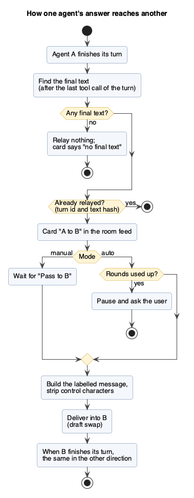
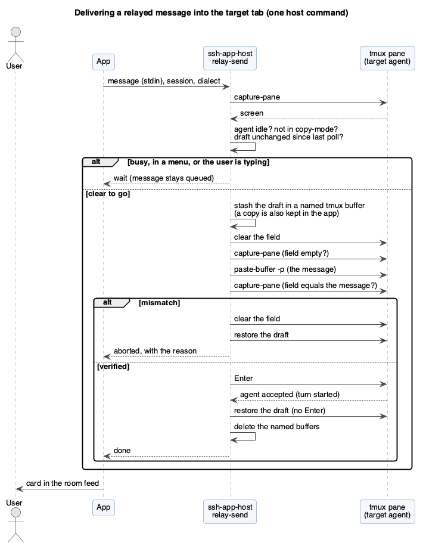

# Agent relay room: how it works

Overview of Feature 51 / M40 (`docs/features/51-two-agent-relay.md`, developed on the branch
`feature/agent-relay`). This page explains the mechanism and the problems it has to survive. Nothing here is built yet:
the spec is written, the live checks of section 7 are still to do.

## 1. The idea

A **room** joins two or more agent tabs (Claude Code, Antigravity, ...). The app carries the **final answer** of one agent to
another as if the user had typed it, and shows the exchange as a clean feed: only what each agent said, without thinking,
tool calls or terminal noise. The user reads, passes, pauses and interrupts at any time. The app is the relay: the agents
never talk to each other directly, so nothing needs to be installed in them and the zero-battery rule holds (the relay
runs only while the app is in the foreground).



## 2. What is relayed

- Only the assistant's **final text** of a turn: the text after the last tool call. A turn that ends on a tool call or an
  error relays nothing. An option relays all text blocks of the turn (off by default).
- Never relayed: thinking, tool calls and results, status lines, menus, the user's own messages, and the relayed messages
  themselves (so a relayed message cannot bounce back as a "reply").
- A turn is finished when the source tab shows no spinner, no menu and an unchanged screen for two polls; the `Stop` hook
  shortens that to the event when it is installed.
- The text comes from the agent's session file when available (exact Markdown), otherwise from the screen feed (with the
  styles restored from the SGR codes).
- Every relayed turn is remembered by turn id and a hash of its text, so re-parsing or reconnecting never sends it twice.
  A room starts "from now": earlier history is not relayed.

## 3. Delivering into the target tab without losing what the user is typing

The target tab may hold a half-typed message. The whole delivery runs **on the host in one command**
(`ssh-app-host relay-send`, one SSH exec), not as several round trips from the phone, so the window for races is a few
hundred milliseconds.



1. Check the target: not working, no menu or question, not in tmux copy-mode, the draft unchanged since the previous poll.
   Otherwise the message waits (up to 30 s) and the room shows "waiting for <tab>".
2. Stash the draft in app memory and storage, and in a **named** tmux buffer (never the user's own top buffer). A draft over
   16 KB is not swapped: the relay tells the user instead.
3. Clear the field with the agent's own key, then verify by capture that it is empty.
4. Paste the relay message as a bracketed paste (safe for several lines), verify the field holds exactly the message,
   press Enter.
5. Wait until the agent accepts it (a new turn starts).
6. Paste the stashed draft back, without Enter. The user sees their text returned and the agent already working.

Any mismatch aborts: the field is cleared and the draft restored. If the app is killed in the middle, the draft survives
in app storage and in the tmux buffer, and the next launch offers to restore it.

## 4. The message

```
[Relayed from <label> (room "<name>", message <n>)]
<text>
```

The first character is always `[`, so the text can never begin with `/`, `!`, `#` or `@` and be taken for a slash command,
shell mode, memory note or file mention. Control characters and escape sequences are removed; the cap is 8,000 characters
(longer texts are cut at a paragraph end outside code fences, with a notice, and stay complete in the room). With more than
two members, the messages produced since the target's last turn are batched into one message, one block per sender. The label
is not a defence: the receiving agent treats the text as untrusted input.

## 5. What the user sees

One room feed. Each relayed message is a card "agy to claude" with the Markdown text, the time and the round number; the
user's own messages appear as theirs; thinking, bash calls and spinners do not appear. "Details" opens the member's own full
feed. The header shows the members, whose turn it is, rounds left and the mode, with **Pause** and **Stop** always visible.

- **Manual** (default): each finished turn has a "Pass to <tab>" button.
- **Auto**: relayed automatically up to the round limit (default 6, user-set), then the room pauses and asks.

## 6. Problems foreseen

| Problem | What is done |
|---|---|
| The user's draft is lost or mixed with the message | Stash, clear, paste, restore, each verified; backups in the app and a named tmux buffer; abort on any mismatch |
| The user types during the swap | A quiet-field check first, the input locked in the app during the swap, verification catches foreign typing |
| Target is busy, in a menu, a question or a permission prompt | Nothing is typed into it; the message stays queued; a permission prompt is answered on the phone first |
| Pane in copy-mode or scrollback | Detected (`pane_in_mode`) and cancelled before any key |
| Relayed text taken as a command | Label line first, bracketed paste, control characters removed |
| Prompt injection travelling between agents | Text labelled untrusted, manual mode by default, round limit, the target's own permission flow and the auto-approval floor still apply |
| Endless or expensive loops | Round and wall-clock limits, usage guard, Pause and Stop; auto mode is off by default |
| The same message sent twice | Idempotent per source turn (id and text hash) |
| No final text found | Nothing is relayed and the card says so; the session file is preferred over the screen |
| Phone in the background | The relay pauses; on return only the latest unrelayed text per source is sent |
| A member tab closes or the agent exits | The room pauses; the target must be recognised as the same agent before each delivery, a plain shell prompt aborts |
| Two profiles in one room (work and personal) | Profiles shown in the header; the first relay across different profiles needs explicit confirmation |
| Secrets in an answer reaching another agent or account | Same host and user assumed; cross-profile confirmation; relayed text is not logged outside the app and the agents' own files |
| Differences between agents (hint lines, queued messages, vim-mode input) | Delivery uses the dialect parser's draft, status and prompt; vim-mode disables the relay into that tab |
| Test safety | Tests use a private tmux socket and never the user's server; real agents are tried only with the personal profile |

## 7. Still to check live (phase 0)

Run in a private tmux with `claude-personal` and `agy`:

1. Which key empties a non-empty multi-line field in each agent, and what vim-mode does.
2. How each agent shows a long multi-line paste, and that Enter sends it whole.
3. What each agent does with a message pasted while it is working (queued, rejected, interrupting).
4. Whether text starting with `[` is ever interpreted specially.
5. How long the whole swap takes at normal SSH latency.

## 8. Related

- Spec: `docs/features/51-two-agent-relay.md` (branch `feature/agent-relay`).
- Parent feature: `docs/features/37-multi-agent-trio-chat.md` (phase 1, client relay).
- Screen parsing and styles: `docs/architecture/screen-parser.md`.
- Why MCP is not used for this: `docs/architecture/mcp-channel-study.md`.
