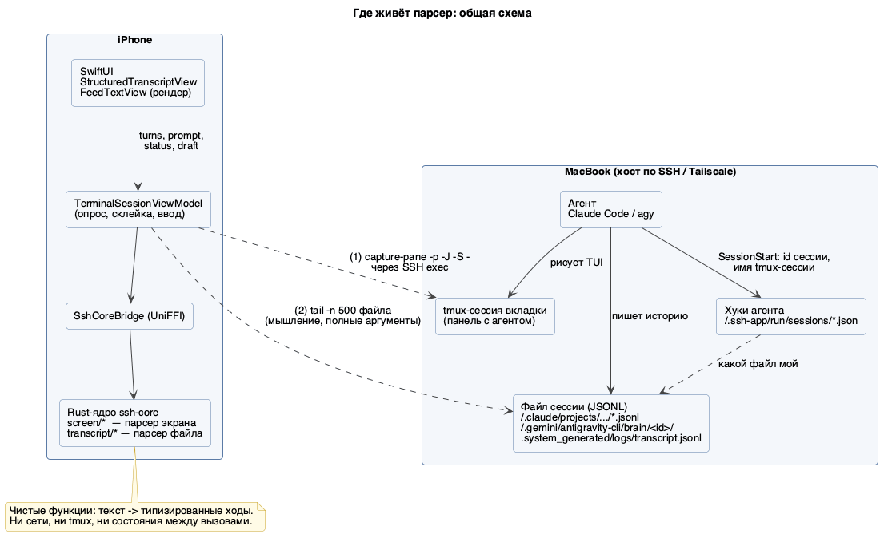
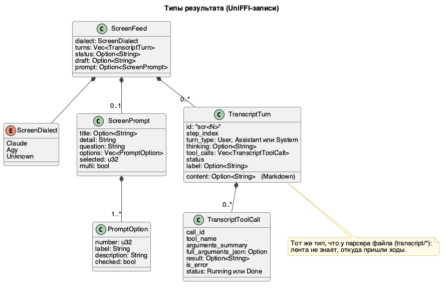
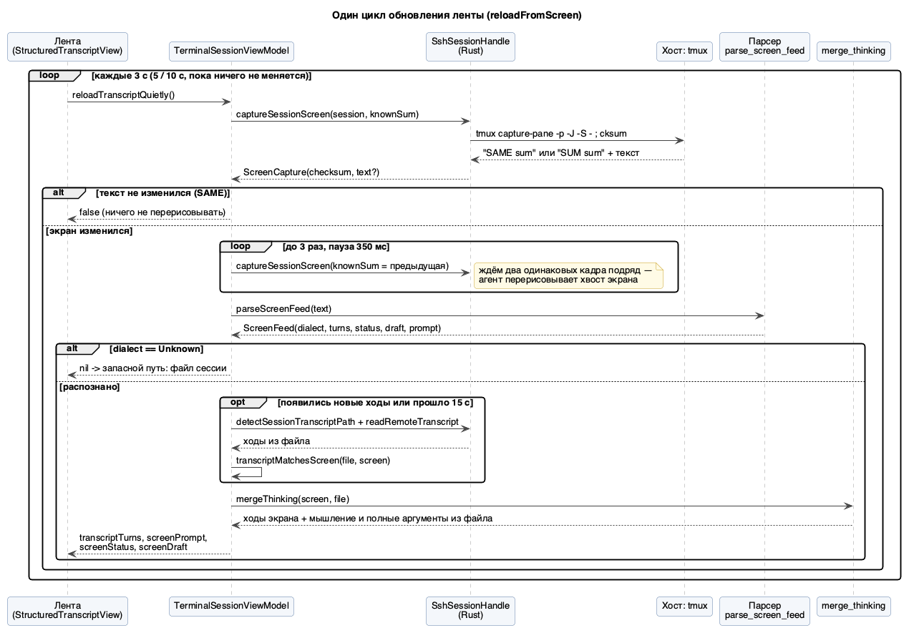
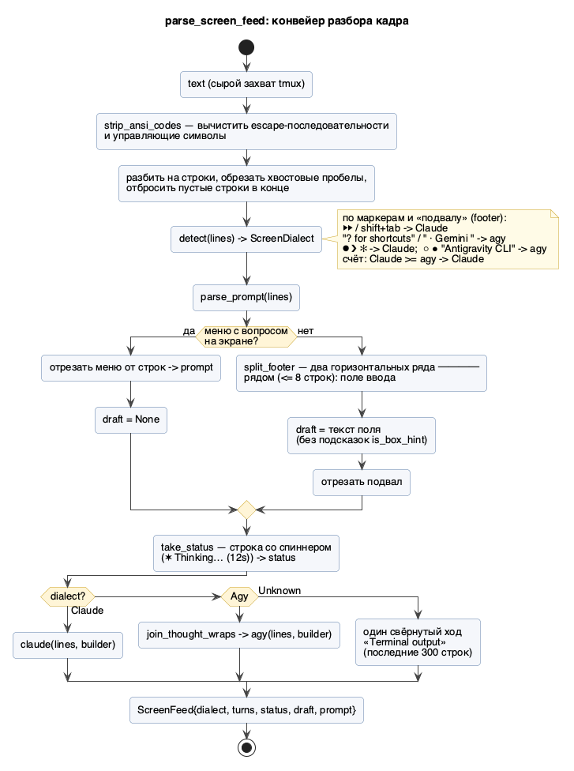
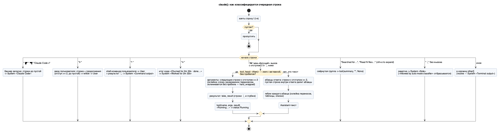
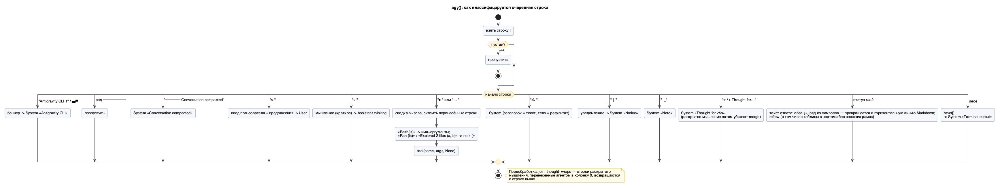
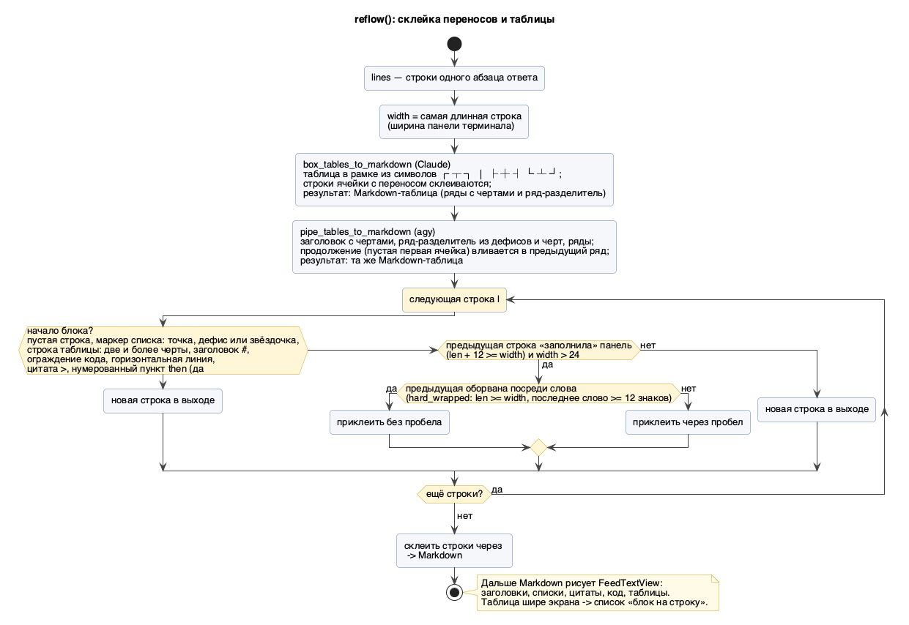
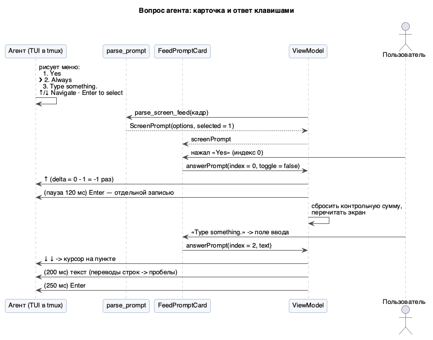
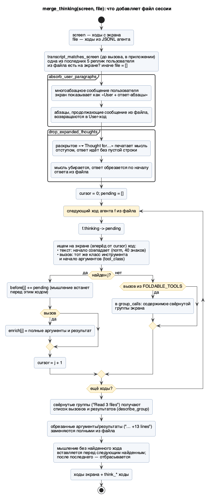

# Парсер экрана агента: как лента получает ходы из tmux

Статус: описание того, что реализовано (2026-10-21). Код: `crates/core/src/screen/`, потребители —
`ios/Sources/SSHApp/ViewModels/TerminalSessionViewModel.swift` и `StructuredTranscriptView.swift`.
Схемы в формате PlantUML лежат в `diagrams/*.puml`, готовые PNG рядом.
Как посмотреть настоящие экраны: `make tmux-dump` (только чтение, `TMUX_DUMP_FLAGS=-e` оставляет цвета).

## 1. Зачем он нужен

Лента («Feed») показывает разговор с агентом как читаемый чат, а не как сетку терминала. У ленты два
источника:

| Источник | Что в нём хорошо | Что плохо |
|---|---|---|
| **Файл сессии** (JSONL агента) | полный Markdown, мышление, полные аргументы и результаты, точные границы ходов | нет того, что агент ещё не записал; нет меню вопросов, спиннера, поля ввода; нужно найти «свой» файл |
| **Экран tmux** (`capture-pane`) | ровно то, что видит пользователь: живой хвост, меню разрешений, спиннер, набранный текст, раскрытая история | текст без стилей, обрезанные результаты, перенесённые строки, разметка потеряна |

Парсер экрана превращает кадр панели в те же `TranscriptTurn`, что даёт парсер файла, поэтому лента не
знает, откуда пришли ходы. Файл сессии потом добавляет то, чего нет на экране (§8).



## 2. Что парсер получает и что возвращает

Вход — одна строка: текст кадра. Хост снимает его скриптом `CAPTURE_SCREEN_SCRIPT`
(`host_api/mod.rs`):

```
tmux capture-pane -p -J -S - -t "=<сессия>:"      # весь скроллбэк, строки tmux склеены (-J)
cksum                                              # контрольная сумма: если не изменилась — ответ «SAME»
```

`-J` склеивает строки, которые перенёс сам tmux, но не те, которые агент разбил сам, поэтому перенос
слов остаётся задачей парсера (§6). Стилей и цветов в этом режиме нет.

Выход — `ScreenFeed` (UniFFI-запись):



| Поле | Смысл |
|---|---|
| `dialect` | `Claude`, `Agy` или `Unknown` (ничего не узнано: приложение идёт в запасной путь — файл сессии) |
| `turns` | ходы в порядке экрана: `User`, `Assistant` (текст / мышление / вызов инструмента), `System` (баннер, заметка, «Worked for…») |
| `status` | живая строка агента со спиннером («✶ Thinking… (12s)»), не ход |
| `draft` | то, что набрано в поле ввода агента и ещё не отправлено |
| `prompt` | вопрос на экране, который ждёт ответа (разрешение, выбор, форма) |

Функция — `parse_screen_feed(text)`, чистая: без сети, tmux и состояния между вызовами. Её можно гонять
на каждом опросе.

## 3. Цикл обновления в приложении



Ключевые решения (`TerminalSessionViewModel.reloadFromScreen`):

- **Контрольная сумма.** Если экран не изменился, хост отвечает `SAME`, текст не передаётся и не
  разбирается.
- **Два одинаковых кадра.** Агент перерисовывает хвост (спиннер, приходящий результат, печатаемый ответ).
  Кадр, снятый в середине перерисовки, даёт «кашу» в конце ленты. Поэтому после изменения приложение
  снимает экран ещё до трёх раз с паузой 350 мс и берёт первый стабильный кадр.
- **Частота.** 3 с, пока лента меняется; 5 с, затем 10 с, когда всё стоит (каждый опрос — удалённая
  команда, разбор и вёрстка, телефон от этого греется).
- **Запасной путь.** `Unknown` → вкладка читается из файла сессии. Агент в обычном shell распознаётся
  по хуку или процессу, а не по экрану.

## 4. Конвейер разбора кадра



Шаги по порядку (`screen/mod.rs`, `parse_screen_feed`):

1. **Очистка.** `strip_ansi_codes` убирает escape-последовательности и управляющие символы: панель —
   недоверенные данные, через парсер не проходит ничего управляющего. Хвостовые пробелы строк и пустые
   строки в конце отбрасываются.
2. **Определение агента** (`detect`). Каждая строка голосует: подвал Claude (`⏵⏵`, `shift+tab to cycle`) или
   метки `⏺ ❯ ✻` — за Claude; подвал agy (`? for shortcuts`, ` · Gemini ` + `accept-edits`) или метки
   `○ ●`, `Antigravity CLI`, `Conversation compacted` — за agy. Подвал считается отдельно, потому что на
   экране он есть всегда, даже когда проскроллена вся часть с метками. Побеждает большее число;
   при равенстве — Claude; ноль голосов — `Unknown`.
3. **Вопрос** (`parse_prompt`, §7). Меню заменяет поле ввода, поэтому оно отрезается первым — остальные
   стадии не должны видеть его строки.
4. **Подвал** (`split_footer`). Поле ввода — это два горизонтальных ряда из `─` (не дальше 8 строк друг от
   друга). Между ними — набранный текст (`draft`), без префикса `❯`/`>` и без подсказок агента вроде
   «Press up to edit queued messages» (`is_box_hint`). В режиме Ctrl+O («Showing detailed transcript»)
   поля ввода нет, подвал — одна строка с рядом над ней.
5. **Статус** (`take_status`). Последняя непустая строка, начинающаяся со спиннера
   (`✶ ✳ ✢ ✽ · ✻ *` или брайлевские точки) и содержащая `…` вместе с `esc to interrupt`, `…)` или `… (`, —
   это `status`, а не ход.
6. **Разбор диалекта.** `claude()` или `agy()` строят ходы (§5). `Unknown` даёт один свёрнутый ход
   «Terminal output» из последних 300 строк.

## 5. Грамматика экранов

Разбор — один проход по строкам с «жадным» поглощением продолжений; каждая строка попадает ровно в один
ход, нераспознанное собирается в «Terminal output» и не теряется.

### 5.1 Claude Code



| Маркер в начале строки | Что это | Результат |
|---|---|---|
| `▐▛`, `▝▜`, `Claude Code v` | баннер запуска | `System` «Claude Code» |
| `❯ ` | ввод пользователя (продолжения с отступом ≥ 2) | `User` |
| `! ` | shell-команда пользователя | `User` + `System` «Command output» |
| `✻ ` | итог хода («Churned for 2m 32s · done 6:56 PM») | `System` «Worked for 2m 32s» (глагол меняется, длительность — новость) |
| `⏺ ` + `Имя(` | вызов инструмента | `Assistant` с `tool_calls` |
| `⏺ ` + текст | ответ | `Assistant` с `content` (Markdown) |
| «Searched for…», «Read N files… (ctrl+o to expand)» | свёрнутая группа вызовов | пустой вызов с названием группы |
| `⎿` | результат/заметка | к вызову выше или `System` «Note» |

Тонкости:

- **Вызов или текст** решает `tool_head`: имя до `(` — обычный идентификатор с заглавной буквы
  (`Bash`, `Read`, `mcp__x__y`). «Это (тест)» вызовом не считается.
- **Мигающий `⏺`.** Маркер работающего вызова мигает, и кадр может поймать вызов без него:
  `running_tool` узнаёт `  Bash(…` с отступом 2, аргументами глубже и строкой `⎿` ниже.
- **Аргументы** склеиваются со следующими строками с отступом ≥ 2; слово, разорванное терминалом посреди
  (`hard_wrapped`), склеивается без пробела. После Ctrl+O скрипт печатается целиком, пустые строки внутри
  него принадлежат вызову, если дальше текст всё ещё с отступом аргументов.
- **Результат** (`take_result`) — строки `⎿` и более глубокие. «Running…» → `status = Running`.
- **Заметка «Allowed by auto mode classifier»** отбрасывается: она приходит после каждого автоодобренного
  вызова, это причина, а не новость, и она рвала бы серию вызовов, которую лента сворачивает.
- **Абзацы ответа.** Строка с отступом ≥ 2 — продолжение; пустая строка внутри ответа делит абзацы, если
  дальше всё ещё отступ ≥ 2 (и это не свёрнутая группа и не `⎿`).

### 5.2 Antigravity CLI (agy)



| Маркер | Что это |
|---|---|
| `Antigravity CLI 1…`, `▄ ▀` | баннер → `System` |
| `> ` | ввод пользователя → `User` |
| `○ ` | краткое мышление → `Assistant.thinking` |
| `● ` / `… ` | сводка вызова: `Bash(ls)`, `Ran (ls)`, `Explored 2 files (a, b)` → вызов |
| `⚠ ` | предупреждение с телом |
| `┃` | уведомление → `System` «Notice» |
| `▾ / ▸ Thought for 25s` | заголовок раскрытого мышления |
| `──── Conversation compacted ────` | сжатие беседы |
| отступ ≥ 2 | текст ответа (ряд `─` внутри — горизонтальная линия) |

Особенность agy: раскрытое мышление агент переносит сам, и перенесённые строки возвращаются в колонку 0
(первая строка каждого абзаца с отступом). `join_thought_wraps` возвращает такую строку к строке выше — до
следующего маркера (вызов, результат, ввод, ряд, спиннер).

## 6. Склейка переносов и таблицы (`reflow`)



Агент сам разбивает строки по ширине своей панели, поэтому `-J` их не склеивает. `reflow` решает по ширине
панели (самая длинная строка абзаца):

- Предыдущая строка «заполнила» панель (`длина + 12 ≥ ширина`, ширина > 24), а следующая — обычное
  продолжение, не начало блока → склеить. Начало блока: пустая строка, маркер списка, строка таблицы,
  заголовок `#`, ограждение кода, линия, цитата, нумерованный пункт.
- Строка оборвана посреди слова (`hard_wrapped`: заполняет панель до последней колонки и кончается
  словом ≥ 12 знаков — путь, URL) → склеить **без** пробела.

**Таблицы.** До склейки строки таблиц возвращаются в Markdown, чтобы приложение нарисовало настоящую таблицу:

- Claude рисует таблицу рамкой (`┌─┬─┐`, `│ a │ b │`, `├─┼─┤`, `└─┴─┘`), а длинную ячейку переносит на несколько
  `│`-строк. `box_tables_to_markdown` склеивает строки одной ячейки и выдаёт Markdown-ряды с рядом-разделителем.
  Рамка без закрывающей строки таблицей не считается, строки остаются как были.
- agy рисует таблицу чертами без внешних: заголовок, ряд `-----|-----`, ряды; перенесённая ячейка даёт строку
  с пустой первой ячейкой. `pipe_tables_to_markdown` вливает такие строки в предыдущий ряд.

Что делать, если таблица шире экрана телефона: Markdown-таблица, которую рисует `FeedTextView`, превращается в
список «блок на ряд» (первая ячейка — заголовок, остальные — `Название: значение`), как это делает Claude.

## 7. Вопросы агента (`parse_prompt`)



Меню — это пронумерованные пункты прямо над строкой подсказки клавиш («↑/↓ Navigate · Enter to select ·
Esc to cancel»). Алгоритм:

1. Найти подсказку в последних 8 строках (`navigate`, иначе `enter to select|confirm` в последних 6).
   Форма Claude с вкладками («`←  ☒ A  ☐ B  ✔ Submit  →`») без подсказки определяется по полосе вкладок.
2. От подсказки вверх собрать пункты, считая номера вниз до 1 (`option_re`: курсор `>`/`❯`, галочка-коробка,
   номер, текст). Перенесённые подписи без номера присоединяются к пункту. Нумерованный список в обычном
   ответе выше меню меню не считается: оно должно доходить до подсказки.
3. Над вопросом — деталь (команда, файл) до горизонтальной линии, над ней — заголовок. Строка
   «Requesting permission…» отбрасывается.
4. Результат — `ScreenPrompt`: `question`, `options`, `selected` (где курсор), `multi` (есть коробки).

Ответ приложение даёт **клавишами**, не текстом: стрелки до пункта, затем Enter (выбор) или Space
(коробка). Enter — отдельной записью после паузы, иначе агент примет его за часть вставки. Пункт
«Type something.» открывает поле ввода: курсор ставится на пункт, текст печатается, затем Enter.

## 8. Что добавляет файл сессии (`merge_thinking`)



Экран не показывает мышление и режет аргументы и результаты («… +13 lines»); файл сессии хранит всё целиком.
Приложение читает файл («tail -n 500») не чаще раза в 15 с, а при новых ходах на экране — сразу, и проверяет,
что это файл **той же** беседы (`transcript_matches_screen`: одна из последних пяти реплик пользователя есть
на экране; два агента одного вида могут работать в одной папке).

Затем `merge_thinking`:

1. `absorb_user_paragraphs` — многоабзацное сообщение пользователя агент рисует как первый абзац у приглашения
   и остальное отступом, что выглядит как ответ; абзацы, которыми сообщение из файла продолжается, возвращаются
   в `User`-ход.
2. `drop_expanded_thoughts` — раскрытое «Thought for…» печатает мысль отступом, ответ идёт без пустой строки;
   мысль убирается (merge вставит мышление из файла), ответ режется по началу ответа из файла.
3. Основной проход — по ходам агента из файла, вперёд по экрану: ход находится по началу текста (нормализация,
   40 знаков) или по классу инструмента (`tool_class`: `Bash`≈`run_command`, `Read`≈`view_file`…) и началу
   аргументов. Найденному ходу достаются накопленное мышление (перед ним), полные аргументы и результат.
4. Свёрнутые группы («Read 3 files») получают список вызовов и результатов из файла (`describe_group`,
   фильтр шума сборки вроде «Compiling…», до 40 строк на результат).
5. Мышление, ход которого не найден, вставляется перед следующим найденным; после последнего — **отбрасывается**,
   а не ставится в неверное место.

## 9. Безопасность и пределы

- Панель — недоверенные данные: нет escape-последовательностей, текст ограничен (2 000 000 знаков на кадр),
  результаты режутся (`clip`), `full_arguments_json` приходит только из файла.
- Парсер не исполняет и не отправляет ничего: ввод ответа делает приложение клавишами, команды проходят
  обычную проверку (`validate_session_name`, цитирование).
- Хрупкость по построению: парсер знает **вёрстку** TUI. Новая версия агента может поменять маркеры;
  страховка — `Unknown` + файл сессии, нераспознанное в «Terminal output», тесты на настоящих снимках.

Известные ограничения:

- Стили (жирный, курсив, код, цвета) теряются: `capture-pane` без `-e` их не отдаёт. Разметка Claude/agy,
  которая выражена только стилем (заголовки Claude, жирный, инлайн-код), на экране не восстанавливается —
  её даёт файл сессии. План: `docs/architecture/chat-extraction-alternatives.md`.
- Строки подагентов на экране Claude не распознаются отдельно (счётчик подагентов берётся из файла).
- Ширина панели берётся как самая длинная строка абзаца: узкие абзацы короче панели не склеиваются.
- Таблица со вставками `|` в ячейках может разобраться неверно (экранирования в обоих агентах нет).

## 10. Тесты и отладка

- Юнит-тесты: `crates/core/src/screen/tests.rs` (35), настоящие снимки: `crates/core/tests/data/`
  (`claude_ctrl_o.txt`, `claude_box_table.txt`, `agy_pipe_table.txt`).
- Проверка на живых панелях: `make tmux-dump` → файлы в `$TMPDIR/ssh-app-tmux-dump`; `TMUX_DUMP_FLAGS=-e`
  сохраняет цвета. Тесты никогда не трогают настоящий tmux (правило `AGENTS.md`).
- Как добавить поддержку нового маркера: снять живой экран → положить фрагмент в `tests/data` → тест на
  `parse_screen_feed` → правка в `claude.rs`/`agy.rs` (одна ветка `if let Some(rest) = l.strip_prefix(...)`).

## 11. Карта кода

| Файл | Ответственность |
|---|---|
| `screen/mod.rs` | типы, `parse_screen_feed`, `detect`, `split_footer`, `take_status`, `Builder` |
| `screen/claude.rs` | диалект Claude, `running_tool`, `tool_head`, `join_thought_wraps` |
| `screen/agy.rs` | диалект agy |
| `screen/prompt.rs` | `parse_prompt`, регулярка пунктов |
| `screen/text.rs` | `reflow`, `hard_wrapped`, таблицы (`box_tables_to_markdown`, `pipe_tables_to_markdown`) |
| `screen/tools.rs` | `tool_class`, `FOLDABLE_TOOLS`, `readable_result_lines`, `describe_group` |
| `screen/merge.rs` | `merge_thinking`, `transcript_matches_screen` и его помощники |
| `host_api/transcript.rs` | `capture_session_screen`, чтение файла сессии |
| `TerminalSessionViewModel.swift` | опрос, два одинаковых кадра, ответ на вопрос, слияние |
| `FeedTextView.swift` | рендер Markdown: заголовки, списки, код, таблицы |
