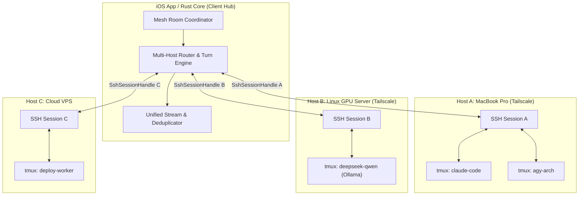

# Feature 37: Multi-Agent Mesh & Cross-Server Room Federation (N-Session & Cross-Host Collaboration)

- **Slug**: `multi-agent-mesh-federation`
- **Target Release**: Milestone 26 (Collaborative Multi-Agent Intelligence)
- **Roles**: `doc-dev`, `rust-core-dev`, `swift-bridge-dev`, `ios-ui-dev`, `rev`, `hacker`
- **Hacker Gate**: Yes (multi-session execution dispatch, cross-host message routing, distributed workspace locks)
- **Status**: Reviewed and corrected (`rev`, 2026-10-20). Ship phases 1-2 first; phases 4-5 and the direct host-to-host plane are separate, later specs.

---

## 1. Problem Statement & Scope

### 1.1 The Vision
Modern engineering environments are rarely limited to one machine or one agent:
- A developer may run **Claude Code** on a MacBook for swift UI iteration, **Antigravity CLI (agy)** for core architecture, and a **local DeepSeek / Qwen model via Ollama** on a separate dedicated Linux GPU server for high-throughput code review or test generation.
- Furthermore, on a single machine, developers frequently run **multiple parallel sessions** (e.g. Session 1: iOS frontend agent, Session 2: Rust core agent, Session 3: background test runner).

The developer needs a **unified collaboration room (Mesh Room)** where:
1. **N sessions on the same host** can be dynamically checked into a conference room.
2. **Cross-server federation** allows bridging sessions across different remote hosts (e.g. `macbook` + `gpu-box` + `cloud-vps`) over secure SSH/Tailscale tunnels coordinated by the client.
3. Every agent can see, critique, and build upon the work of others under human oversight without file-write race conditions or runaway token loops.

### 1.2 Invariants & Architectural Rules
1. **Strict No-Emoji Mandate**: Zero emojis in all interfaces, headers, cards, badges, and code. All iconography relies exclusively on Apple's **SF Symbols** (`server.rack`, `terminal.fill`, `cpu.fill`, `person.fill`, `network`, `lock.fill`, `checkmark`, `xmark`) and clean ASCII/Unicode typographic markers (`●`, `○`, `⬡`, `❯`, `⎿`, `[✓]`, `[✕]`).
2. **Gradual Phased Implementation**:
   - **Phase 1**: Dual-Session Bridge (Claude + agy manual relay on one host).
   - **Phase 2**: Driver & Reviewer (Lead developer + automated cross-auditor).
   - **Phase 3**: MCP Peer Bridge (On-demand consultation tool).
   - **Phase 4** (later milestone): Local N-Session Mesh Room (Arbitrary sessions on a single host with turn limits).
   - **Phase 5** (later milestone): Cross-Server Mesh Federation (Multi-host coordination via client-side relay).
   - Only phases 1-2 are in the first release; each later phase needs its own `rev`.
3. **Zero Battery Drain (and what that means for rounds)**: every agent-to-agent round passes through the client, so rounds pause while the app is in the background and continue when it returns; only a host-to-host file transfer could be autonomous (see 3.2). Room coordination operates over existing `SshSessionHandle` channels. Backgrounding closes client TCP sockets instantly. Background tmux sessions continue on their respective hosts.
4. **Workspace leases, enforced**: write operations (`Edit`, `Write`, `git commit`) require an exclusive lease on the repository. A lock file alone blocks nothing, because the agents' own tools do not read it; the lease is enforced by a `PreToolUse` hook that denies writes without it, and reviewers run read-only.

---

## 2. Visual Identity & UI Design System (No Emojis)

### 2.1 Participant & Host Visual Matrix

| Entity | Type | Glyphs | Color Coding | SF Symbol | Addressing Key |
| :--- | :--- | :---: | :--- | :--- | :--- |
| **User (You)** | Human | `❯` | Accent Tint (`Color.appAccent`) | `person.fill` | `@user` / `You` |
| **Claude Code** | Agent | `●` | Amber / Rust (`#F59E0B` / `#D97706`) | `terminal.fill` | `@<host>/claude` |
| **Antigravity (agy)** | Agent | `○` | Cyan / Sky (`#38BDF8` / `#0284C7`) | `cpu.fill` | `@<host>/agy` |
| **Local LLM (Ollama)** | Agent | `⬡` | Purple / Violet (`#A855F7` / `#7C3AED`) | `brain.fill` | `@<host>/ollama` |
| **Custom Shell** | Shell | `>_` | Monochrome Muted (`#64748B`) | `terminal` | `@<host>/<name>` |
| **Remote Host** | Machine | `H:` | Secondary Label | `server.rack` | `<host-slug>` |

---

### 2.2 Wireframe 1: Multi-Session Room Header & Active Participants

```text
┌───────────────────────────────────────────────────────────┐
│ [ < Rooms ]   Mesh: Architecture Review             [ ⚙ ] │
│               2 Hosts · 3 Agents Active · ssh-app         │
├───────────────────────────────────────────────────────────┤
│ Active: [● mac/claude] [○ mac/agy] [⬡ gpu/deepseek] [ + ] │ <-- Горизонтальный скролл участников
├───────────────────────────────────────────────────────────┤
│                                                           │
│ 14:10:02 ❯ User (to @all):                                │
│ Нужно согласовать архитектуру кросс-серверного брокера.   │
│ ───────────────────────────────────────────────────────── │
│                                                           │
│ 14:10:20 ● mac/claude:                                    │
│ Предлагаю использовать легковесный binary protocol через  │
│ именованные пайпы на хосте и клиентский SSH ретранслятор. │
│ [ ↳ Pass to @all ]       [ ↳ Pass to @gpu ]      [ Copy ] │
│ ───────────────────────────────────────────────────────── │
│                                                           │
│ 14:10:45 ⬡ gpu/deepseek-r1:                               │
│ Замечание по масштабированию: клиентский ретранслятор     │
│ создаёт узкое горлышко при передаче больших diffs.        │
│ Для крупных логов хосты должны поднимать прямое mTLS 1.3  │
│ соединение с пинингом SHA-256 отпечатка сертификата,      │
│ независимо от того, какая сеть под ними (WAN, IP или TS). │
│ [ ↳ Pass to @claude ]                            [ Copy ] │
│ ───────────────────────────────────────────────────────── │
│                                                           │
│ 14:11:10 ○ mac/agy:                                       │
│ Поддерживаю предложение deepseek по mTLS 1.3.             │
│ Давайте зафиксируем контракт: Client-Relay для сообщений, │
│ mTLS 1.3 сокет для тяжелых артефактов и diffs.           │
│                                                           │
├───────────────────────────────────────────────────────────┤
│ Target: [ All (3) ]  [ mac/claude ]  [ gpu/deepseek ]     │
├───────────────────────────────────────────────────────────┤
│ [Esc] [Tab] [^C] [↑] [↓]                                  │
│ [paperclip] ❯ @all Утверждаем схему с прямым сокетом...[⏎]│
└───────────────────────────────────────────────────────────┘
```

---

### 2.3 Wireframe 2: Participant Drawer / Session Picker Sheet (`RoomParticipantsSheetView`)

Modal sheet invoked by tapping `[ + ]` or `[ ⚙ ]` in the room header:

```text
┌───────────────────────────────────────────────────────────┐
│ Room Participants & Sessions                      [ Done ]│
├───────────────────────────────────────────────────────────┤
│ CONNECTED HOSTS & OPEN SESSIONS                           │
│                                                           │
│ server.rack macbook-pro.tailnet (Primary)                 │
│   [✓] ● claude-code-ui        Claude 3.7   (Driver: Write)│
│   [✓] ○ antigravity-arch      agy 1.4      (Auditor: Read)│
│   [ ] >_ build-terminal       zsh          (Worker)       │
│                                                           │
│ server.rack linux-gpu-rig.tailnet                         │
│   [✓] ⬡ deepseek-r1-qwen      Ollama 32B   (Consultant)   │
│   [ ] >_ tensor-train-log     bash         (Observer)     │
│                                                           │
│ server.rack vps-deploy.tailnet                            │
│   [ ] ● claude-deploy         Claude Code  (Idle)         │
│                                                           │
├───────────────────────────────────────────────────────────┤
│ CONCURRENCY & WRITE LEASES                                │
│ Repository: /Users/ivs/rust/ssh-app                       │
│ Active Write Lock: macbook-pro:claude-code-ui             │
│ [ Release Lock ]           [ Grant to Selected Agent ]    │
├───────────────────────────────────────────────────────────┤
│ TURN LIMITER & CIRCUIT BREAKER                            │
│ Max Autonomous Rounds: [ - ] 3 Rounds [ + ]               │
│ Stop on Consensus: [✓] Enabled                            │
└───────────────────────────────────────────────────────────┘
```

---

## 3. Cross-Server Architecture & Communication Topology



### 3.1 Why Client-Coordinated Federation is Optimal
1. **Zero Host-to-Host Keys Required**: Host A and Host B do not need SSH keys to each other. Both machines only trust the developer's client (iPhone/Mac) via their existing Keychain Ed25519 keys.
2. **Firewall Traversal**: Each host is already connected to the client over its own encrypted SSH tunnel (e.g. over Tailscale). The client simply pipes the output of Host A as formatted input into Host B.
3. **Auditing & Inspection**: Every message traveling between Host A and Host B passes through the client's router, ensuring human visibility, rate limiting, and approval checks.

### 3.2 Direct host-to-host plane: removed from this spec

The earlier design (mTLS inside UDP after STUN hole punching, a blind TCP relay on a VPS, a Cloudflare WebSocket relay) is **not part of this feature**. Reasons: mTLS over UDP after hole punching needs QUIC or DTLS (the helper has no such stack, and a TLS-over-TCP description does not fit UDP); a listener on `0.0.0.0` on a laptop is unacceptable (a listener binds the tailnet interface only, if it ever exists); the NAT percentage and the Cloudflare plan limits were not sourced and must be checked against the provider before being quoted; and phases 1-2 do not need it.

The transport for phases 1-5 is the SSH channel the client already has to each host: the client reads Host A's turn and writes it to Host B (3.1). If direct transfer of large artifacts is wanted later, it is a separate spec that names one transport and one library, binds the tailnet interface only, and states which parts work while the phone sleeps.

### 3.3 Disconnected client

With the relay through the client, nothing agent-to-agent continues while the phone is asleep: a round that is waiting for the client waits. Work already running on a host inside `tmux` continues. Rooms therefore show "waiting for the phone" instead of pretending to be autonomous.

---

## 4. Domain Models & Rust/Swift Protocol Contracts

### 4.1 Swift Types (`MeshModels.swift`)

```swift
public struct MeshHostRef: Identifiable, Hashable {
    public let id: String          // e.g. "macbook-pro"
    public let hostname: String    // e.g. "100.82.14.12"
    public let label: String       // e.g. "MacBook Pro M3"
}

public struct MeshParticipant: Identifiable, Hashable {
    public let id: String          // e.g. "macbook-pro:claude-ui"
    public let host: MeshHostRef
    public let sessionName: String
    public let agentKind: AgentKind // .claudeCode, .antigravity, .localLlm, .customShell
    public var role: MeshRole       // .driver, .auditor, .consultant, .observer
    public var isWriteLockHolder: Bool
}

public enum MeshRole: String, CaseIterable, Identifiable {
    case driver = "driver"         // Has write permission to repo
    case auditor = "auditor"       // Automated code reviewer (read-only)
    case consultant = "consultant" // Provides second opinion on prompts
    case observer = "observer"     // Receives transcript, no output

    public var id: String { rawValue }
    public var title: String {
        switch self {
        case .driver: return "Driver (Write)"
        case .auditor: return "Auditor (Read-Only)"
        case .consultant: return "Consultant"
        case .observer: return "Observer"
        }
    }
}

public struct MeshMessage: Identifiable, Equatable {
    public let id: String
    public let sourceParticipant: MeshParticipant
    public let targetSelector: String // "@all", "@macbook/claude", "@gpu/qwen"
    public let timestamp: Date
    public let text: String
    public let toolCalls: [TranscriptToolCall]
    public let roundIndex: Int
}
```

### 4.2 Rust Core Interface (`crates/core/src/mesh.rs`)

```rust
use crate::error::SshCoreError;
use std::collections::HashMap;

#[derive(Debug, Clone, PartialEq, Eq, uniffi::Record)]
pub struct HostSessionTarget {
    pub host_id: String,
    pub session_name: String,
    pub agent_kind: String,
}

#[derive(Debug, Clone, PartialEq, Eq, uniffi::Record)]
pub struct MeshRoomConfig {
    pub room_id: String,
    pub title: String,
    pub participants: Vec<HostSessionTarget>,
    pub max_rounds: u32,
    pub stop_on_consensus: bool,
}

#[derive(Debug, Clone, PartialEq, Eq, uniffi::Record)]
pub struct MeshDispatchPlan {
    pub target_sessions: Vec<HostSessionTarget>,
    pub formatted_payload: String,
    pub caller_host_id: String,
    pub round: u32,
}

/// Routes user input or cross-agent reply to target sessions across host boundaries.
pub fn plan_mesh_dispatch(
    config: &MeshRoomConfig,
    sender_session: Option<HostSessionTarget>,
    selector: &str, // "@all", "@macbook/claude", etc.
    raw_message: &str,
    current_round: u32,
) -> Result<MeshDispatchPlan, SshCoreError> {
    // Validates round limits, parses @mentions, wraps content in delimiter tags
    // and returns destination list with formatted bracketed-paste bytes.
    todo!()
}
```

---

## 5. Phased Implementation Roadmap

### Phase 1: Dual-Session Bridge (Claude + agy on one host)
- Paired tmux sessions `<session>-claude` and `<session>-agy`.
- Interleaved timeline viewer in the app with `[Pass to other]` relay button.

### Phase 2: Driver & Reviewer Dual Card
- One agent drives (`claude`), second agent audits (`agy`).
- Approval sheet displays side-by-side plan and automated audit verdict.

### Phase 3: MCP Peer Consultation Bridge
- Local stdio MCP server on the host: `consult_peer(target, prompt)`.
- On-demand calls folded into neat tool-call accordions.

### Phase 4: Local N-Session Mesh Room
- User creates a room on a single server, selecting any N active tmux sessions.
- In-memory room coordinator handles round limits and `@session` mentions.

### Phase 5: Cross-Server Federation
- Multi-host coordination in `TerminalSessionViewModel` / `MeshManager`.
- Routes messages between Server A (`SshSessionHandle`) and Server B (`SshSessionHandle`).
- Client-side relay: Server A writes text $\rightarrow$ Client receives turn $\rightarrow$ Client sends to Server B via PTY/stdin.
- Distributed write lease: only one session across all servers may hold the write lease for a shared repository, enforced by the `PreToolUse` hook. Phase 5 is a separate milestone with its own spec and `rev`.

---

## 6. Security & Concurrency Considerations

1. **Distributed Write Locks**:
   - Before an agent executes `Edit` or `Write`, the `PreToolUse` hook checks the lease record (`.git/ssh-app-mesh.lock` is only the record) and denies the call without it; reviewers are started read-only. On a shared network mount the same hook runs on each host.
2. **Circuit Breaker (Anti-Runaway Token Protection)**:
   - Maximum autonomous rounds = 3 (configurable up to 6).
   - If two agents exchange replies without human input for 3 cycles, the room pauses automatically with status `[PAUSE] Round Limit Reached. Human review required.`.
3. **Cross-Host Sanitization**:
   - Messages passing from Host A to Host B are stripped of terminal control codes (`ESC[...]`) and wrapped in `<agent-context host="..." session="...">`. The wrapper is a label, not a defence: **cross-agent text is untrusted input**, and every relayed turn is shown to the user and sent on only after approval (an "auto-relay" switch per room exists and is off by default).
4. **Zero Battery Drain**:
   - Backgrounding the iOS app tears down all SSH TCP channels to all servers. Long-running tasks on Host A and Host B continue unimpeded inside `tmux`. On foregrounding, the client reconnects and syncs timelines across all participating hosts.

---

## Review (`rev`, 2026-10-20) - applied

Folded in above: rounds are not phone-independent; the direct plane and all NAT strategies are removed; no `0.0.0.0` listener; the lease is enforced by a hook; relayed text is untrusted and shown before it is sent; unsourced numbers dropped; scope is phases 1-2.
