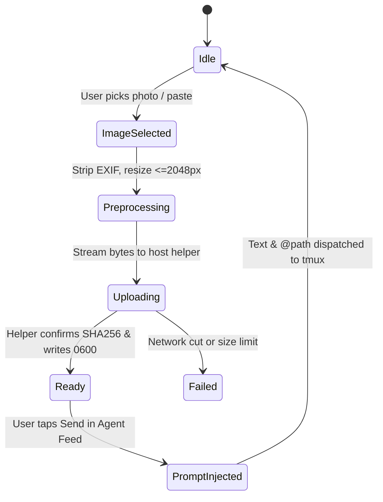

# Feature 38: Multimodal Agent Uploads & Mobile Screenshot Pipeline

- **Slug**: `multimodal-agent-uploads`
- **Target Release**: Milestone 27 (Multimodal Mobile Agent Control)
- **Roles**: `doc-dev`, `rust-core-dev`, `swift-bridge-dev`, `ios-ui-dev`, `rev`, `hacker`
- **Hacker Gate**: Yes (file upload channels, path traversal, shell injection in agent prompts, image EXIF sanitization)
- **Status**: Reviewed and corrected (`rev`, 2026-10-20). First release: Claude Code and Ollama; agy after a live test.

---

## 1. Problem Statement & Scope

### 1.1 The User Problem
Modern autonomous software agents (Claude Code, Google Antigravity, local multimodal LLMs via Ollama) natively accept image inputs for visual UI debugging, layout error resolution, and diagram analysis.
Currently, a mobile engineer testing an iOS app or web interface on an iPhone who encounters a visual glitch must:
1. Take a screenshot on the phone.
2. AirDrop or upload it to their Mac.
3. Move it to the project directory.
4. Manually run `claude` or `agy` with the path on the Mac.

This breaks the mobile-first paradigm of remote autonomous engineering.

### 1.2 In Scope
- Mobile photo library, camera, and system clipboard image acquisition in SwiftUI.
- Client-side pre-flight processing: HEIC to PNG/JPEG conversion, image dimension clamping (max 2048x2048), metadata/EXIF stripping (GPS, device identifiers).
- Upload transport over existing `SshSessionHandle` (SFTP or typed helper stdin pump) into a dedicated per-session sandboxed directory: `~/.ssh-app/run/uploads/<sha256>.<ext>`.
- Retention: **no cleanup daemon** (nothing runs on the host without a phone session). The helper prunes files older than the TTL (default 24 h) and over the quota when a phone session connects, and removes stale `.tmp` files then.
- Dynamic prompt injection:
  - Claude Code: `@~/.ssh-app/run/uploads/<hash>.png`. **Verified on a live session before the feature is called working**; until then this is a design.
  - Antigravity (`agy`): not supported in the first release. How agy receives an image is undefined; it is added only after a live test shows a mechanism.
  - Ollama multimodal (`llava`, `bakllava`, `minicpm-v`): the phone never talks to Ollama. The image is uploaded over SSH (helper `upload-image`), and a second helper call on the host reads the stored file, base64-encodes it and calls the host's own `127.0.0.1:11434/api/generate`; the answer comes back over the same channel.
  - A host **without the helper** gets nothing: the attach button explains "install the host helper" instead of failing silently.
- Visual preview chip inside the mobile Agent Feed composer bar with tap-to-remove.

### 1.3 Out of Scope
- Direct raw video streaming or screen recording uploads (images only: PNG, JPEG, WebP).
- Client-side OCR (OCR is delegated to the multimodal agent on the remote host).

---

## 2. Domain Models & Protocol Contracts

### 2.1 Rust Core Domain Models (`crates/core/src/uploads.rs`)

```rust
use std::path::PathBuf;

#[derive(Debug, Clone, Copy, PartialEq, Eq)]
pub enum ImageFormat {
    Png,
    Jpeg,
    Webp,
}

impl ImageFormat {
    pub fn extension(&self) -> &'static str {
        match self {
            Self::Png => "png",
            Self::Jpeg => "jpg",
            Self::Webp => "webp",
        }
    }

    pub fn mime_type(&self) -> &'static str {
        match self {
            Self::Png => "image/png",
            Self::Jpeg => "image/jpeg",
            Self::Webp => "image/webp",
        }
    }
}

#[derive(Debug, Clone)]
pub struct UploadedImageDescriptor {
    pub file_hash: String,       // SHA-256 hex (64 chars)
    pub remote_path: String,     // Absolute path: ~/.ssh-app/run/uploads/<hash>.<ext>
    pub size_bytes: u64,
    pub width: u32,
    pub height: u32,
    pub format: ImageFormat,
}

#[derive(Debug, thiserror::Error)]
pub enum UploadError {
    #[error("Image exceeds maximum allowed size ({size} > {max})")]
    PayloadTooLarge { size: u64, max: u64 },

    #[error("Unsupported image magic bytes")]
    InvalidImageFormat,

    #[error("SSH transport failure: {0}")]
    Transport(String),

    #[error("Host helper rejected upload: {0}")]
    HostRejected(String),

    #[error("IO error: {0}")]
    Io(#[from] std::io::Error),
}
```

### 2.2 UniFFI Interface

```rust
#[uniffi::export]
impl SshSessionHandle {
    /// Uploads an image payload into the host session scratchpad.
    /// Returns the remote path and metadata for prompt interpolation.
    pub async fn upload_agent_image(
        &self,
        raw_bytes: Vec<u8>,
        format_hint: String,
    ) -> Result<UploadedImageDescriptor, SshCoreError>;

    /// Cleans up any expired uploaded images on the remote host.
    pub async fn prune_uploaded_images(
        &self,
        older_than_seconds: u64,
    ) -> Result<u32, SshCoreError>;
}
```

### 2.3 Swift Platform Types (`ios/Sources/Models/AgentUpload.swift`)

```swift
import SwiftUI

public struct PendingImageAttachment: Identifiable, Equatable {
    public let id: UUID
    public let thumbnail: UIImage
    public let localData: Data
    public let format: String
    public var uploadState: UploadState

    public enum UploadState: Equatable {
        case pending
        case uploading(progress: Double)
        case ready(remotePath: String, hash: String)
        case failed(error: String)
    }
}
```

---

## 3. Remote Host Environment & Protocol

### 3.1 Host Directory Structure
All uploads reside strictly within user-isolated permissions:
```text
$HOME/.ssh-app/
└── run/
    └── uploads/             (chmod 0700)
        ├── 8f3c...0a.png    (chmod 0600)
        ├── b21d...3e.jpg    (chmod 0600)
        └── .cleanup.lock
```

### 3.2 Upload Pipeline
1. Client verifies header magic bytes (PNG: `89 50 4E 47`, JPEG: `FF D8 FF`, WebP: `52 49 46 46`).
2. Client computes SHA-256 digest `hash`.
3. Over the SSH exec channel, the client invokes:
   ```bash
   ~/.ssh-app/bin/ssh-app-host upload-image --hash <hash> --ext <ext> --size <bytes>
   ```
   and streams bytes through `stdin` (capped at 10 MB per image).
4. The host helper verifies that:
   - The size matches.
   - The computed SHA-256 matches the argument.
   - The path is strictly `$HOME/.ssh-app/run/uploads/<hash>.<ext>` with no path traversal (`..` or `/` in hash/ext).
   - Writes atomically via temp file (`<path>.tmp`) and renames.

---

## 4. State Machines & Lifecycle



- **Zero Battery Drain**: If the app is backgrounded while an upload is in flight, the TCP socket tears down immediately. The unfinished `.tmp` file is purged by the helper on the next connect.
- **Cache Hit**: If an image with the same SHA-256 already exists in `uploads/`, the helper returns the existing path immediately without re-transferring bytes.

---

## 5. Security & Threat Modeling (Hacker Gate)

| Threat Vector | Mitigation Strategy |
| :--- | :--- |
| **Path Traversal (`../..`)** | Helper rejects any `--hash` that is not exactly 64 lowercase hex characters `[0-9a-f]{64}`. Extension strictly whitelisted: `png`, `jpg`, `webp`. |
| **Shell Command Injection via File Path** | Remote path is fully deterministic: `$HOME/.ssh-app/run/uploads/<64-hex>.<ext>`. No user-provided string is used in paths. |
| **Sensitive EXIF Leakage (GPS, Serial)** | Swift client passes all images through `UIGraphicsImageRenderer` / `CoreGraphics` without preserving image metadata dictionaries before dispatch. |
| **Disk Exhaustion DOS** | Hard limit of 10 MB per file, max 100 MB total directory quota. Oldest files pruned on connect when the quota is exceeded; 24-hour TTL default. |
| **Symlink Attacks** | `uploads/` directory must be owned by the user with `0700` permissions. Symlinks are rejected via `O_NOFOLLOW` and `symlink_metadata`. |

---

## 6. Verification & Test Suite

1. **Rust Core Tests**:
   - `test_upload_valid_png_and_verify_sha256`: loopback test against ephemeral sshd.
   - `test_reject_path_traversal_in_hash`: rejects `../../etc/passwd`.
   - `test_upload_size_limit_exceeded`: rejects files > 10 MB.
   - `test_cache_hit_skip_reupload`: verifies identical hash returns immediately.
   - `test_prune_on_connect_removes_old_and_tmp_files`.
   - `test_missing_helper_gives_a_clear_message`.
   - Live checks (not unit tests): Claude Code reads an `@path` image; the Ollama path answers for a `llava` model.
2. **Swift UI Tests**:
   - Photo picker integration and thumbnail chip rendering.
   - Composer bar text formatting with image references.
   - Error handling upon network teardown.

---

## Review (`rev`, 2026-10-20) - applied

Folded in above: Claude Code and Ollama first, agy after a live test; `@path` verified live; no cleanup daemon (prune on connect); the Ollama path written down; behaviour without the helper.
