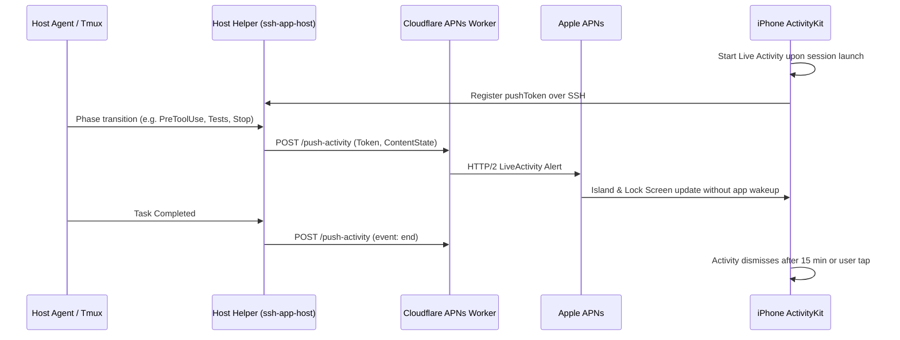

# Feature 39: Live Activities & Dynamic Island for Long-Running Agent Tasks

- **Slug**: `live-activities-and-dynamic-island`
- **Target Release**: Milestone 28 (Real-Time Ambient Agent Monitoring)
- **Roles**: `doc-dev`, `rust-core-dev`, `swift-bridge-dev`, `ios-ui-dev`, `rev`, `hacker`
- **Hacker Gate**: Yes (ActivityKit push tokens, APNs relay payloads, remote control from lock screen)
- **Status**: Design Complete. Ready for `rev`.

---

## 1. Problem Statement & Scope

### 1.1 The User Problem
Autonomous AI agents executing complex engineering workflows (e.g. running 400 integration tests, large refactors, dependency compilation) often run for 2 to 15 minutes.
Currently, when a developer minimizes the app or locks their phone:
- Under our **Zero Battery Drain** model, the TCP socket closes immediately.
- The user has no ambient awareness of agent progress without either:
  1. Unlocking the phone and re-entering the app (triggering a reconnect).
  2. Waiting for a static push notification when the agent completes or blocks.

### 1.2 In Scope
- Apple **ActivityKit** Live Activity integration for iPhone (Lock Screen widget + Dynamic Island: Compact, Minimal, and Expanded views).
- Strict adherence to the **No-Emoji Mandate**: exclusively SF Symbols (`cpu.fill`, `play.fill`, `stop.fill`, `checkmark`, `xmark`, `clock.arrow.circlepath`) and clean typography.
- Event-driven push updates from the remote host via the existing Cloudflare Worker APNs push relay ([35-push-relay.md](file:///Users/ivs/rust/ssh-app/docs/features/35-push-relay.md)).
- Dynamic states:
  - `Thinking` (Agent reasoning, token count, elapsed time)
  - `ToolExecuting` (Tool name: `Bash`, `Edit`, `Read`, `Grep`)
  - `TestRunning` (Test progress counter: `42/128 passed`)
  - `WaitingApproval` (Urgent pulse, countdown timer, tool target)
  - `Completed` / `Failed`
- Lock Screen action buttons:
  - Interactive `Stop` button (sends `SIGINT` to the agent pane via a quick SSH command or background action).
  - Tap deep-links into the specific active agent session tab.

### 1.3 Out of Scope
- Direct continuous streaming of terminal output to the Dynamic Island (bandwidth and APNs rate limits make this impossible; state updates occur on phase transitions or at most every 5 seconds).

---

## 2. Activity Attributes & State Models

### 2.1 Swift ActivityKit Attributes (`ios/SSHAppWidgets/AgentLiveActivity.swift`)

```swift
import ActivityKit
import SwiftUI

public struct AgentTaskActivityAttributes: ActivityAttributes {
    public struct ContentState: Codable, Hashable {
        public var phase: AgentPhase
        public var currentTool: String?
        public var progressCurrent: Int?
        public var progressTotal: Int?
        public var durationSeconds: Int
        public var isWaitingApproval: Bool
        public var targetHost: String
        public var agentGlyph: String // "●" for Claude, "○" for agy, "⬡" for Ollama

        public enum AgentPhase: String, Codable, Hashable {
            case thinking = "THINKING"
            case runningTool = "TOOL"
            case runningTests = "TESTS"
            case waitingApproval = "APPROVAL"
            case completed = "COMPLETED"
            case failed = "FAILED"
        }
    }

    public var sessionName: String
    public var projectName: String
    public var hostSlug: String
}
```

### 2.2 APNs Push Payload Format
Pushes for ActivityKit updates use `apns-push-type: liveactivity` and target the activity's unique push token registered by the iOS app:

```json
{
  "aps": {
    "timestamp": 1729432000,
    "event": "update",
    "content-state": {
      "phase": "TESTS",
      "currentTool": "cargo test",
      "progressCurrent": 48,
      "progressTotal": 120,
      "durationSeconds": 134,
      "isWaitingApproval": false,
      "targetHost": "macbook-pro",
      "agentGlyph": "●"
    },
    "alert": {
      "title": "Tests Running (48/120)",
      "body": "Claude Code is executing the test suite"
    }
  }
}
```

---

## 3. Dynamic Island & Lock Screen UI Layouts

### 3.1 Dynamic Island Wireframes (No Emojis)

```text
[Compact Leading]        [Compact Trailing]
( ● Claude )            ( [■■■□] 48/120 )

[Minimal]
( ● 48% )

[Expanded View]
┌────────────────────────────────────────────────────────┐
│  ● Claude Code · macbook-pro                 02:14     │
│  Project: ssh-app / core                               │
├────────────────────────────────────────────────────────┤
│  Tool: cargo test --lib                                │
│  Progress: [====================>          ] 48/120    │
├────────────────────────────────────────────────────────┤
│  [ ■ Stop Task ]                   [ ↗ Open Session ]  │
└────────────────────────────────────────────────────────┘
```

### 3.2 Lock Screen Card Layout

```text
┌────────────────────────────────────────────────────────┐
│ [server.rack] macbook-pro      ● Claude Code     03:22 │
│ Refactoring authentication pipeline                    │
├────────────────────────────────────────────────────────┤
│ Status: Running tool `Edit` in `crates/core/auth.rs`   │
│ Elapsed: 3m 22s  ·  12 tool calls                      │
├────────────────────────────────────────────────────────┤
│ [ ■ Abort ]                         [ ↗ View Session ] │
└────────────────────────────────────────────────────────┘
```

---

## 4. State Machines & Lifecycle



- **Zero Battery Drain Guarantees**: The phone's app process remains completely suspended. The APNs push directly updates the system ActivityKit extension without spawning the main app runloop or opening network sockets.
- **Rate-Limiting & Throttling**: The host helper coalesces state updates to a maximum of 1 APNs dispatch per 4 seconds, avoiding APNs 429 throttling and preserving host battery.

---

## 5. Security & Threat Modeling (Hacker Gate)

| Threat | Mitigation |
| :--- | :--- |
| **Push Token Interception** | ActivityKit push tokens are ephemeral, tied exclusively to this device instance, and transmitted strictly over the encrypted SSH tunnel to the host helper. |
| **Lock Screen Unauthorized Abort** | The Lock Screen `Abort` action sends a cryptographically signed instruction or requires Device Unlock (LocalAuthentication) if biometric lock is configured in Settings. |
| **Worker Abuse** | The Cloudflare Worker validates `RELAY_SECRET` and checks that the payload adheres to the strict JSON schema with length <= 1024 bytes. |

---

## 6. Verification & Test Suite

1. **Rust Core Tests**:
   - `test_agent_phase_transition_detector`: parses agent stream markers into typed `AgentPhase`.
   - `test_activity_payload_rate_limiter`: ensures helper limits dispatches to 1 per 4 seconds.
2. **Swift Platform Tests**:
   - Widget preview tests for Compact, Minimal, and Expanded Dynamic Island views.
   - Deep-linking URL handler verification (`sshapp://session/<host>/<session-id>`).
