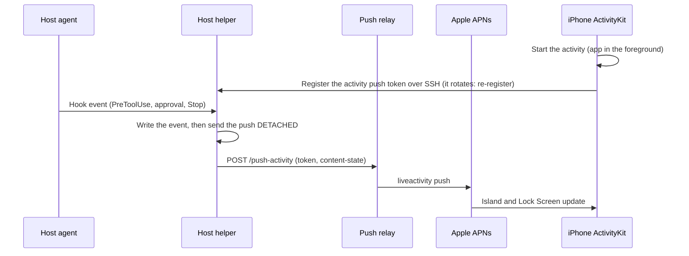

# Feature 39: Live Activities & Dynamic Island for Long-Running Agent Tasks

- **Slug**: `live-activities-and-dynamic-island`
- **Target Release**: Milestone 28 (Real-Time Ambient Agent Monitoring)
- **Roles**: `doc-dev`, `rust-core-dev`, `swift-bridge-dev`, `ios-ui-dev`, `rev`, `hacker`
- **Hacker Gate**: Yes (ActivityKit push tokens, APNs relay payloads, remote control from lock screen)
- **Status**: Reviewed and corrected (`rev`, 2026-10-20). Needs a new relay protocol and a device test before it is promised (section 4).

---

## 1. Problem Statement & Scope

### 1.1 The User Problem
Autonomous AI agents executing complex engineering workflows (e.g. running 400 integration tests, large refactors, dependency compilation) often run for 2 to 15 minutes.
Currently, when a developer minimizes the app or locks their phone:
- Under our **Zero Battery Drain** model, the TCP socket closes immediately.
- The user has no ambient awareness of agent progress without either:
  1. Unlocking the phone and re-entering the app (triggering a reconnect).
  2. Waiting for a static push notification when the agent completes or blocks.

### 1.2 In Scope
- Apple **ActivityKit** Live Activity for iPhone (Lock Screen + Dynamic Island: Compact, Minimal, Expanded).
- **No-Emoji Mandate**: SF Symbols only.
- Event-driven updates from the host through the push relay ([35-push-relay.md](35-push-relay.md)), with the **new Live Activity protocol** of section 4.
- States (phase codes only): `Thinking`, `Tool` (a tool is running; its name is not sent), `Approval` (waiting for the user), `Done`, `Failed`. There is no test progress: hooks see the command, not its output, so "42/128" cannot be derived.
- Lock Screen actions: `Stop` and a tap that opens the session. Stop starts SSH from a background intent with seconds of runtime, which is unproven; if it does not fit, the button opens the app instead (device test required, section 6).

### 1.3 Out of Scope
- Streaming terminal output to the Island. At most one push per state change; elapsed time is drawn by the system from a start date (`Text(timerInterval:)`), never pushed.

---

## 2. Activity Attributes & State Models

### 2.1 Swift ActivityKit attributes (`ios/SSHAppWidgets/AgentLiveActivity.swift`)

The static attributes are set by the app when it starts the activity, locally, so they may hold the names the user already sees. Only `ContentState` travels in a push, and it holds codes and numbers.

```swift
public struct AgentTaskActivityAttributes: ActivityAttributes {
    public struct ContentState: Codable, Hashable {
        public var phase: AgentPhase          // code, mapped to words by the app
        public var toolCalls: Int             // a counter, not names
        public var startedAt: Date            // for Text(timerInterval:)

        public enum AgentPhase: String, Codable, Hashable {
            case thinking = "T", runningTool = "X", waitingApproval = "A", completed = "D", failed = "F"
        }
    }

    public var sessionName: String   // local, never pushed
    public var projectName: String   // local, never pushed
    public var hostSlug: String      // local, never pushed
    public var agentGlyph: String    // "●" Claude, "○" agy, "⬡" Ollama
}
```

### 2.2 Push payload

```json
{ "aps": { "timestamp": 1729432000, "event": "update",
           "content-state": { "phase": "X", "toolCalls": 12, "startedAt": 1729431866 } } }
```

No `alert` text, no tool name, no command, no path (the push rule of feature 35). The relay adds `apns-push-type: liveactivity` and the topic `<bundle>.push-type.liveactivity`.

---

## 3. Dynamic Island & Lock Screen UI Layouts

Words come from the app's own mapping of the phase code ("Thinking", "Running a tool", "Waiting for you", "Done", "Failed"). The time is the system timer.

```text
[Compact Leading]   [Compact Trailing]       [Minimal]
( ● Claude )        ( 02:14 )                ( ● )

[Expanded]
┌────────────────────────────────────────────────────────┐
│  ● Claude Code · macbook-pro                 02:14     │
│  Project: ssh-app                                      │
├────────────────────────────────────────────────────────┤
│  Running a tool · 12 tool calls                        │
├────────────────────────────────────────────────────────┤
│  [ ■ Stop ]                         [ ↗ Open Session ] │
└────────────────────────────────────────────────────────┘
```

Lock Screen: the same fields in a card (host, agent, timer, phase words, tool-call count, Stop, View Session).

---

## 4. State machine, relay protocol and lifecycle



- **New relay protocol, not a tweak.** Live Activities need topic `<bundle>.push-type.liveactivity`, `apns-push-type: liveactivity`, the per-activity token and `content-state` instead of `alert`. The relay gets its own endpoint and tests; the existing `alert` endpoint is untouched.
- **The hook never waits for the network.** The helper forks the push and returns at once (hooks are synchronous).
- **An activity can only be started while the app is in the foreground.**
- **Budget.** Pushes are throttled by the system; the helper sends one push per state change, never on a timer, and merges changes closer than the configured minimum interval (feature 46: 4..60 s).
- **Shared secret.** The relay secret rule of feature 35 section 5 applies: it is not baked into a distributed build; per-install App Attest replaces it before distribution.

---

## 5. Security & Threat Modeling (Hacker Gate)

| Threat | Mitigation |
| :--- | :--- |
| **Push token interception** | The activity token is tied to this device and sent only over the SSH channel to the helper. |
| **Lock Screen unauthorized Stop** | Stop requires device unlock (`authenticationPolicy`, feature 48 names the API); on failure it opens the app. |
| **Worker abuse** | The relay validates its secret and a strict schema (phase from a fixed set, counter within range, body at most 256 bytes). |
| **Leaking work to the lock screen** | The payload has codes and numbers only; names shown come from the local attributes the user already chose to show. A setting hides project and host names on the Lock Screen. |

---

## 6. Verification & Test Suite

1. **Rust Core Tests**: `test_phase_from_hook_event`; `test_one_push_per_state_change_and_merge_within_the_minimum_interval`; `test_payload_has_no_text_fields` (schema allows only the fixed keys); `test_hook_returns_before_the_push_completes` (a stalled relay does not delay the hook).
2. **Relay tests**: the new endpoint rejects an unknown phase, an oversized body and a wrong secret.
3. **Swift Platform Tests**: previews for Compact, Minimal and Expanded; deep link `sshapp://session/<host>/<session-id>`.
4. **Device tests (required before the feature is called working)**: activity start from the foreground, token rotation, update from a push while the app is suspended, and the Stop button from the Lock Screen.

---

## Review (`rev`, 2026-10-20) - applied

Folded in above: phase codes only; a new relay protocol; no test progress; the hook sends detached; foreground start and the Stop fallback; throttling and system timer; shared-secret rule.
