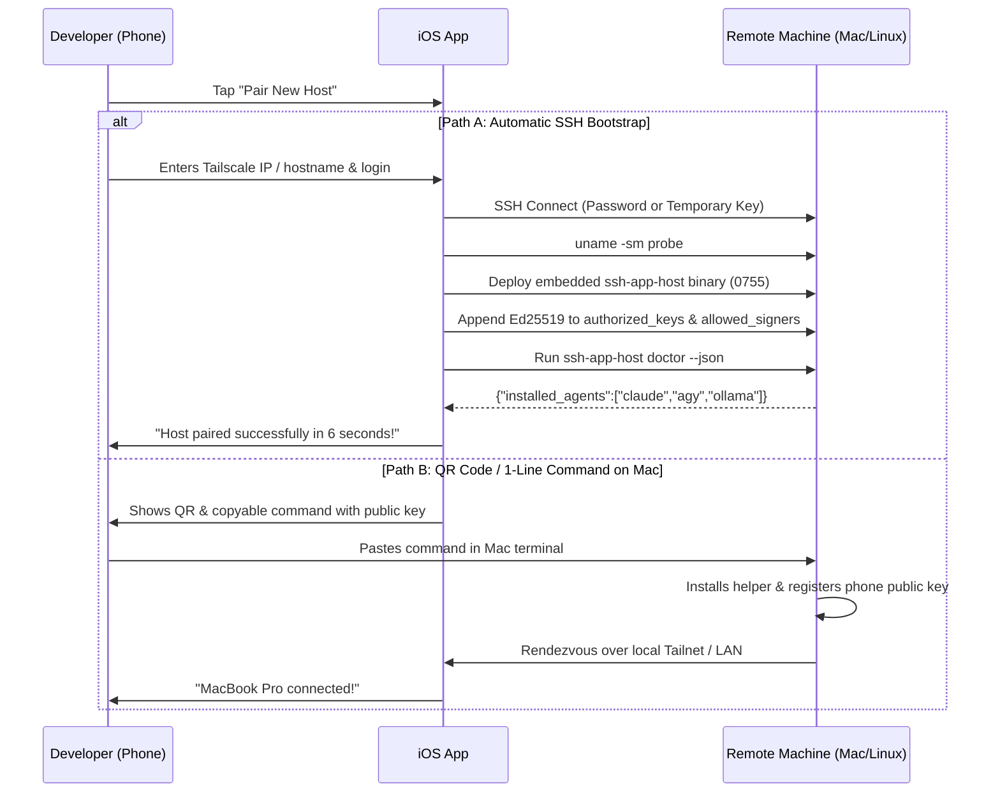

# Feature 44: Zero-Touch Host Onboarding & Instant Pairing

- **Slug**: `zero-touch-host-onboarding`
- **Target Release**: Milestone 33 (1-Minute Frictionless Onboarding)
- **Roles**: `doc-dev`, `rust-core-dev`, `swift-bridge-dev`, `ios-ui-dev`, `rev`, `hacker`
- **Hacker Gate**: Yes (curl-to-sh script security, pinned SHA-256 binary validation, authorized_keys manipulation)
- **Status**: Design Complete. Ready for `rev`.

---

## 1. Problem Statement & Scope

### 1.1 The User Problem
For a new user or when pairing a new development laptop/server:
- The user must currently know their Tailscale or local IP.
- They must manually install the host helper binary (`ssh-app-host`).
- They must install agent approval hooks into `~/.claude/settings.json` or `~/.gemini/config/hooks.json`.
- They must copy the phone's public key into `~/.ssh/authorized_keys` and `~/.ssh-app/allowed_signers`.

This multi-step manual setup causes drop-off and friction.

### 1.2 In Scope
1. **QR Code & Single-Line Pairing**:
   - The iOS app displays a dynamic QR code or a 1-tap copy command:
     ```bash
     curl -fsSL https://pair.ssh-app.dev | sh -s -- --token <ephemeral-nonce>
     ```
   - Alternatively, a direct local command generated for the user:
     ```bash
     ssh-app-host pair --key "ssh-ed25519 AAAA..." --name "My iPhone"
     ```
2. **Automatic Remote Bootstrap via Standard SSH**:
   - If the user simply enters Hostname / Username / Password (or existing SSH key):
     - The iOS app logs in via SSH.
     - The app inspects host OS and architecture (`uname -s`, `uname -m`).
     - Uploads the appropriate embedded native helper binary (`ssh-app-host-darwin-arm64`, `ssh-app-host-linux-x86_64`, etc.).
     - Sets permissions `chmod 0755 ~/.ssh-app/bin/ssh-app-host`.
     - Appends the iPhone's Ed25519 public key to `~/.ssh/authorized_keys` with a clear comment `# ssh-app: <device-name>`.
     - Appends the signing key to `~/.ssh-app/allowed_signers`.
     - Automatically discovers installed agents (Claude Code, Antigravity CLI, Ollama) and prompts: `"Found Claude Code & Ollama. Install approval hooks? [ Install ]"`.
3. **Tailscale MagicDNS Auto-Discovery**:
   - If Tailscale is detected on the local subnet or via Bonjour/mDNS, the app presents a list of available personal machines (`macbook-pro.tailnet`, `gpu-server.tailnet`) for 1-tap connection.

### 1.3 Out of Scope
- Modifying system-wide `/etc/ssh/sshd_config` or requiring root/sudo privileges (the entire setup is user-local in `$HOME`).

---

## 2. Onboarding Workflow & State Machine



---

## 3. Host Doctor Command (`ssh-app-host doctor`)

The host helper provides an automated diagnostics command:
```bash
$ ~/.ssh-app/bin/ssh-app-host doctor --json
```

Output contract:
```json
{
  "version": "1.4.0",
  "os": "darwin",
  "arch": "aarch64",
  "tmux_installed": true,
  "tmux_version": "3.4",
  "tailscale_ip": "100.92.14.88",
  "git_installed": true,
  "agents": {
    "claude_code": {
      "installed": true,
      "config_dir": "/Users/dev/.claude",
      "hooks_installed": true,
      "limits_active": true
    },
    "antigravity": {
      "installed": true,
      "config_path": "/Users/dev/.gemini/config/hooks.json",
      "hooks_installed": false
    },
    "ollama": {
      "running": true,
      "models": ["deepseek-coder:6.7b", "qwen2.5-coder:7b"]
    }
  },
  "signing_key_trusted": true,
  "push_relay_registered": true
}
```

---

## 4. Security & Threat Modeling (Hacker Gate)

| Threat | Mitigation |
| :--- | :--- |
| **Rogue Host Key Injection** | SSH Host Key fingerprint is computed and displayed to the user with a distinct visual hash (identicon / emoji-free visual blocks) before trusting. |
| **Privilege Escalation** | All binaries, sockets, and configuration files are created strictly within the user's `$HOME/.ssh-app` with permissions `0700` and `0600`. Root access is never requested or required. |
| **`authorized_keys` Corruption** | Modifying `authorized_keys` uses an atomic lock file (`authorized_keys.lock`), creates a dated backup (`authorized_keys.bak.<ts>`), and checks for duplicate entries before appending. |
| **Host Helper Tampering** | Embedded binaries in the iOS app carry hardcoded SHA-256 digests. If an existing binary on the host differs in hash, the app prompts for an explicit upgrade. |

---

## 5. Verification & Test Suite

1. **Rust Core Tests**:
   - `test_doctor_json_output_schema_parsing`: validates full serialization of doctor response.
   - `test_atomic_authorized_keys_append_idempotent`: ensures repeated pairings do not duplicate keys.
   - `test_refuse_symlinked_authorized_keys`: prevents symlink redirection attacks.
2. **Swift UI Tests**:
   - New server onboarding wizard step-by-step navigation.
   - Host fingerprint alert confirmation dialog.
