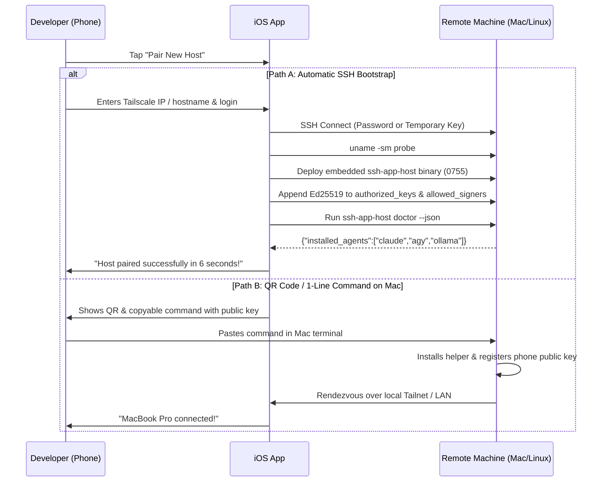

# Feature 44: Zero-Touch Host Onboarding & Instant Pairing

- **Slug**: `zero-touch-host-onboarding`
- **Target Release**: Milestone 33 (1-Minute Frictionless Onboarding)
- **Roles**: `doc-dev`, `rust-core-dev`, `swift-bridge-dev`, `ios-ui-dev`, `rev`, `hacker`
- **Hacker Gate**: Yes (curl-to-sh script security, pinned SHA-256 binary validation, authorized_keys manipulation)
- **Status**: Implemented (2026-10-20): helper `pair` / `doctor`, core, bridge and app (simulator build and tests); not yet run on a phone. See section 7.

---

> **Reading note (2026-10-20):** sections 1-5 are the original design. Where they disagree with section 6.2 (the reviewed design) or section 7 (as built), sections 6 and 7 win. Known differences: no `curl | sh` bootstrap, no rendezvous, pairing goes through the helper `pair` over stdin, `doctor` returns facts only.

## 1. Problem Statement & Scope

### 1.1 The User Problem
For a new user or when pairing a new development laptop/server:
- The user must currently know their Tailscale or local IP.
- They must manually install the host helper binary (`ssh-app-host`).
- They must install agent approval hooks into `~/.claude/settings.json` or `~/.gemini/config/hooks.json`.
- They must copy the phone's public key into `~/.ssh/authorized_keys` and `~/.ssh-app/allowed_signers`.

This multi-step manual setup causes drop-off and friction.

### 1.2 In Scope
1. **QR Code & Single-Line Pairing**:
   - The iOS app displays a dynamic QR code or a 1-tap copy command:
     ```bash
     curl -fsSL https://pair.ssh-app.dev | sh -s -- --token <ephemeral-nonce>
     ```
   - Alternatively, a direct local command generated for the user:
     ```bash
     ssh-app-host pair --key "ssh-ed25519 AAAA..." --name "My iPhone"
     ```
2. **Automatic Remote Bootstrap via Standard SSH**:
   - If the user simply enters Hostname / Username / Password (or existing SSH key):
     - The iOS app logs in via SSH.
     - The app inspects host OS and architecture (`uname -s`, `uname -m`).
     - Uploads the appropriate embedded native helper binary (`ssh-app-host-darwin-arm64`, `ssh-app-host-linux-x86_64`, etc.).
     - Sets permissions `chmod 0755 ~/.ssh-app/bin/ssh-app-host`.
     - Appends the iPhone's Ed25519 public key to `~/.ssh/authorized_keys` with a clear comment `# ssh-app: <device-name>`.
     - Appends the signing key to `~/.ssh-app/allowed_signers`.
     - Automatically discovers installed agents (Claude Code, Antigravity CLI, Ollama) and prompts: `"Found Claude Code & Ollama. Install approval hooks? [ Install ]"`.
3. **Tailscale MagicDNS Auto-Discovery**:
   - If Tailscale is detected on the local subnet or via Bonjour/mDNS, the app presents a list of available personal machines (`macbook-pro.tailnet`, `gpu-server.tailnet`) for 1-tap connection.

### 1.3 Out of Scope
- Modifying system-wide `/etc/ssh/sshd_config` or requiring root/sudo privileges (the entire setup is user-local in `$HOME`).

---

## 2. Onboarding Workflow & State Machine



---

## 3. Host Doctor Command (`ssh-app-host doctor`)

The host helper provides an automated diagnostics command:
```bash
$ ~/.ssh-app/bin/ssh-app-host doctor --json
```

Output contract:
```json
{
  "version": "1.4.0",
  "os": "darwin",
  "arch": "aarch64",
  "tmux_installed": true,
  "tmux_version": "3.4",
  "tailscale_ip": "100.92.14.88",
  "git_installed": true,
  "agents": {
    "claude_code": {
      "installed": true,
      "config_dir": "/Users/dev/.claude",
      "hooks_installed": true,
      "limits_active": true
    },
    "antigravity": {
      "installed": true,
      "config_path": "/Users/dev/.gemini/config/hooks.json",
      "hooks_installed": false
    },
    "ollama": {
      "running": true,
      "models": ["deepseek-coder:6.7b", "qwen2.5-coder:7b"]
    }
  },
  "signing_key_trusted": true,
  "push_relay_registered": true
}
```

---

## 4. Security & Threat Modeling (Hacker Gate)

| Threat | Mitigation |
| :--- | :--- |
| **Rogue Host Key Injection** | SSH Host Key fingerprint is computed and displayed to the user with a distinct visual hash (identicon / emoji-free visual blocks) before trusting. |
| **Privilege Escalation** | All binaries, sockets, and configuration files are created strictly within the user's `$HOME/.ssh-app` with permissions `0700` and `0600`. Root access is never requested or required. |
| **`authorized_keys` Corruption** | Modifying `authorized_keys` uses an atomic lock file (`authorized_keys.lock`), creates a dated backup (`authorized_keys.bak.<ts>`), and checks for duplicate entries before appending. |
| **Host Helper Tampering** | Embedded binaries in the iOS app carry hardcoded SHA-256 digests. If an existing binary on the host differs in hash, the app prompts for an explicit upgrade. |

---

## 5. Verification & Test Suite

1. **Rust Core Tests**:
   - `test_doctor_json_output_schema_parsing`: validates full serialization of doctor response.
   - `test_atomic_authorized_keys_append_idempotent`: ensures repeated pairings do not duplicate keys.
   - `test_refuse_symlinked_authorized_keys`: prevents symlink redirection attacks.
2. **Swift UI Tests**:
   - New server onboarding wizard step-by-step navigation.
   - Host fingerprint alert confirmation dialog.


---

## 6. Review (`rev`, 2026-10-20) and the design that is built

### 6.1 Findings on the first version

1. [High] `curl -fsSL https://pair.ssh-app.dev | sh` makes the project run a hosted script that every
   pairing executes with the user's rights: a domain, a server and a supply chain to defend, in a
   project that has no server and a public repository. Dropped. A host never runs downloaded text.
2. [High] The "rendezvous over the tailnet / LAN" of Path B has no mechanism (no server, no
   discovery protocol, nothing that authenticates the host to the phone). Dropped; the phone always
   connects to the host itself and pins its key.
3. [Medium] Tailscale/MagicDNS discovery by Bonjour does not work: tailnet names are not
   advertised by mDNS and iOS has no API to the Tailscale daemon. Out of scope; the user types the
   name or picks a saved server.
4. [Medium] `doctor` as specified reports interpreted state (`hooks_installed`, `limits_active`,
   `push_relay_registered`) that only the core can judge (hook drift, plan comparison). The helper
   must not duplicate that logic; it reports **facts**, the core interprets them.
5. [Medium] `authorized_keys` handling lacked the cases that break real files: no trailing newline,
   CRLF, a symlinked file or `~/.ssh`, loose modes (`sshd` `StrictModes` then ignores the file), a
   key already present with options, and a device name that contains a newline (which would inject a
   second key line).
6. [Medium] Most of Path A exists: helper install with a digest check (`install_bundled_host_helper`),
   the signer entry (`install_approval_key`), host target probe. The spec re-describes them; the new
   work is only the safe `authorized_keys` append and `doctor`.
7. [Low] Password login is a new credential path in an app that has only keys. The password is used
   once to append the phone's key, is never stored or logged, and is wiped; after pairing the key is
   the only credential.
8. [Low] The test list missed the injection, format and permission cases above.

### 6.2 Design

- **Path A (the only automatic one):** the user enters host, user and a one-time login (password or
  an existing key). The app connects, shows the host key fingerprint for confirmation (existing pin
  flow), installs the helper (digest checked on the host), runs `ssh-app-host pair`, then `doctor`.
- **Path B (manual, no helper needed):** the app shows one ready-to-paste command that appends the
  phone's public key the standard way (`mkdir -p ~/.ssh`, mode 700/600, no duplicate); afterwards the
  app connects with the key and continues as Path A from the helper step. Windows/WSL keep their own
  snippets (feature 33).
- **`ssh-app-host pair`** (helper, runs on the host, user rights only): reads one JSON object from
  **stdin** (`{"key":"ssh-ed25519 AAAA…","name":"My iPhone"}`, never argv, so the key and the name are
  not in `ps`); validates; appends the key to `~/.ssh/authorized_keys`; prints
  `{"ok":true,"added":true|false,"path":"…"}`.
  - `key`: one line, `ssh-ed25519` or `sk-ssh-ed25519@openssh.com` only, base64 body, no options,
    at most 600 characters, no control characters. Anything else is refused.
  - `name` becomes the comment `ssh-app: <name>`: letters, digits, space and `._-` only, at most
    40 characters, otherwise refused (no newline can reach the file).
  - `~/.ssh` and `authorized_keys` are opened with `O_NOFOLLOW`; a symlink at either is refused
    (never followed, never replaced); the directory must be ours and not group/other writable;
    the file is created `0600`, an existing looser mode is tightened to `0600` and reported.
  - Idempotent: if a line with the same key blob exists (with or without options or comment) nothing
    is written, `added:false`.
  - One writer: an exclusive `flock` on `~/.ssh/.ssh-app-pair.lock`; the append is a single
    `write` after making sure the file ends with a newline (a missing final newline is added first);
    CRLF files are appended to as they are. A dated backup `authorized_keys.ssh-app-bak` is kept
    once (the first time the file is changed), not one per pairing.
  - It never removes or rewrites an existing line.
- **`ssh-app-host doctor --json`** (helper, read-only, 4 s budget): facts only, a source that fails is
  left out.
  ```json
  {"ok":true,"version":"0.9.0","os":"darwin","arch":"aarch64",
   "tmux":{"installed":true,"version":"3.4"},
   "git":{"installed":true},
   "tailscale":{"installed":true,"ip":"100.92.14.88"},
   "python3":{"installed":true},
   "agents":{"claude":{"found":true,"config_dir":"/Users/dev/.claude","settings_exists":true},
             "antigravity":{"found":true,"hooks_file":"/Users/dev/.gemini/config/hooks.json","hooks_file_exists":false},
             "ollama":{"found":true,"running":true,"models":["qwen2.5-coder:7b"]}},
   "ssh_app":{"allowed_signers":true,"hook_script":true,"helper_dir_private":true}}
  ```
  Binaries are looked up by walking `PATH` and the usual install dirs (no shell, no `which`); the
  tool versions come from fixed argv (`tmux -V`, `tailscale ip -4`) with a 2 s limit; the Ollama
  model list is the loopback `/api/tags` the helper already reads. No file contents are returned,
  only whether they exist; no secrets.
- **Core:** `HostDoctor` record, `parse_host_doctor`, `build_pair_command(pin, key, name)`
  (stdin-fed, digest-pinned like the other helper calls), `pair_host` and `fetch_host_doctor` on the
  session handle, `pairing_paste_command(public_key, name)` for Path B (validates and quotes), and
  `onboarding_findings(doctor)` that turns facts into the prompts ("Found Claude Code and Ollama.
  Install approval hooks?"), reusing the existing hook plan/drift code.
- **App (after a device run):** wizard with the steps above; the fingerprint confirmation names the
  algorithm and shows the SHA256 as plain text plus colour blocks (no emoji).

### 6.3 Threats added

| Threat | Mitigation |
| :--- | :--- |
| Newline or option injection through the name or key | strict character sets (§6.2), refused, never escaped |
| Key or name in the process list | stdin only |
| `authorized_keys` / `~/.ssh` replaced by a symlink | `O_NOFOLLOW`, refuse, never replace |
| `sshd` ignoring the file because of modes | file `0600`, directory checked, loosened mode tightened and reported |
| Two pairings at once | exclusive `flock` |
| Password kept after pairing | used once in memory, zeroized, never stored; the key is the credential |
| A hosted script | none: no download-and-run anywhere in this feature |

### 6.4 Tests (added to §5)

Helper unit: key/name validation table (options, wrong type, newline, NUL, overlong, unicode name);
append into an empty folder, a file without a final newline, a CRLF file, a file with the key already
present (with options and with a different comment); symlinked file and symlinked `.ssh` refused;
loose mode tightened; backup made once; two concurrent `pair` calls give one line. `doctor`: schema
round trip, a source that fails is left out, `PATH` lookup without a shell, no file contents.
Core: parse of hostile or partial `doctor` replies, `pairing_paste_command` quoting (a key or name
with quotes or `$()` is refused, not escaped), the pinned command shape. Loopback (private HOME, no
real tmux): pair through the installed helper twice, the second adds nothing.

---

## 7. As built (2026-10-20)

Differences from section 6.2, all deliberate:

- `pair` prints `{"ok":true,"added":bool,"tightened":bool}` and no path. The backup is
  `authorized_keys.ssh-app-bak`, made once.
- `doctor` has no Ollama model list (the existing `models` subcommand has it) and returns
  `~`-relative names only. Facts also include `helper_version`, `os`, `arch`.
- Path A has two real steps in the app: (1) the pairing sheet in Add Server (read the host key,
  show it, password once, key added, key pinned); (2) after the first connection, Host service
  installs the helper and "Host check" runs `doctor`. It is not yet one continuous wizard.
- Path B is "Copy the command to run on the host" in Add Server (`pairing_paste_command`).
- The password login exists only for this step (`pair_with_password`); the app still signs in with
  keys everywhere else.
- `onboarding_findings` returns ids (`install-tmux`, `hooks-claude`, ...). The app shows them; the
  buttons that act on them (install hooks, trust the approval key) are the existing cards.
- Tests: helper `pair` 14, `doctor` 9, core `onboarding` 13, loopback sshd (helper pair twice,
  doctor, wrong pin, password path with a wrong and the right host key), Swift `PairingTests` 3.
- Audit: `docs/security-findings/2026-10-20-onboarding-pair-doctor.md`.
