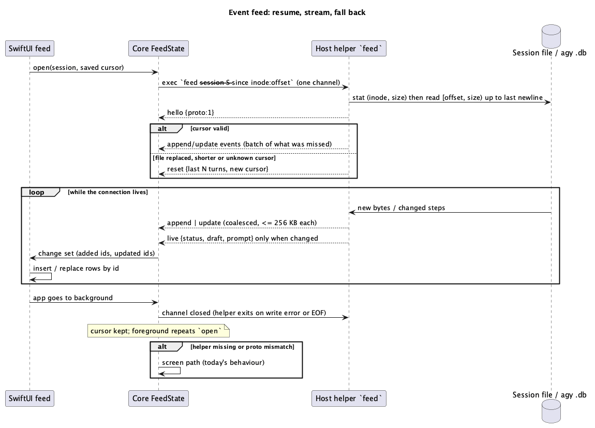

# Feature 55: Event feed (incremental updates instead of re-sending the whole screen)

- **Status**: Reviewed 2026-10-23 (`rev` of the doc: changes applied, see Revision notes). Implemented 2026-10-23 for Claude Code (phases 1–4a) and for Antigravity through its database (helper `agy-conv`/`agy-jsonl`, `watch_agy_feed`, file fallback; no live agy run yet) and subagents of Claude Code (`list_subagents`, `read_subagent_since`, sub-feed screen; polled by cursor every 3 s while the screen is open instead of `sub_open` events; Antigravity child conversations through the helper's `agy-children`, same screen): incremental parser and `FeedState`, read by cursor, stable compressed capture, `watch_feed` stream, Swift wiring that replaces polling while the stream runs. Findings: `docs/security-findings/2026-10-23-event-feed.md`. Open: phase 4b (splice only new screen lines), agy through its database, subagents. Deviations: the transcript path is passed by the app (validated twice) instead of detected in the stream; the stream is a `sh` loop, not a helper command; applying a chunk twice is not idempotent (cursor and `reset` prevent repeats). Follows `docs/architecture/performance-audit-2026-10-23.md`, bottlenecks 1, 2, 3, 6, 7.
- **Agents**: Claude Code first (its session file is already JSON lines). Antigravity: studied 2026-10-23, see §8; events are possible through its SQLite store, but only after a spike.

## 1. Purpose

Today every change makes the app fetch the whole pane history (up to megabytes), parse it, rebuild all turns and compare them. The owner's idea: send **events** (JSON, one per change) and add the newest message to the feed without redrawing the rest. The agents already write events: every line of the Claude session file is one JSON record, and the app only needs the new ones.

## 2. Model

Two independent streams, both as small events with a sequence number:

| Stream | Source | Events | Carries |
|---|---|---|---|
| **Turns** | the agent's session file (JSONL), read from a saved byte offset | `append` (new turns), `update` (a turn whose tool call got its result or whose text grew), `reset` (file replaced or shorter) | typed turns with stable ids |
| **Live** | the pane (the last ~60 lines only) | `live` with `status`, `draft`, `prompt`, `dialog`, `aside` — sent only when they differ from the last one | what the screen shows and the file does not (spinner, input box, questions, `/btw`, dialogs) |

The feed on the phone is `turns` (from events, keyed by id) plus the live part. Older history stays on the host; loading it on scroll (`history`) is **not** part of the first release (the window is today's last 3000 records).



```
host helper (long-lived exec, NDJSON)        core (Rust)                  Swift
 file offset + inode ──► {"seq":41,"ev":"append","turns":[…]} ─► FeedState.apply ─► @Published change set
 pane tail checksum  ──► {"seq":42,"ev":"live","status":…}    ─► FeedState.apply ─► only the live card
```

## 3. Behaviour

- **Cursor**: the app keeps `(inode, offset)` per session; `seq` numbers events **within one helper process** only (a new process starts at 1 and says so in its `hello`), so it orders events but is not a resume key. On start and after every foreground return it sends the cursor; the host answers with the missed events as one batch (`since`), then continues streaming while the connection lives. Background: the socket is closed as today (zero battery drain); nothing runs on the host without a phone session.
- **Gap or mismatch** (seq jump, inode change, offset beyond the file): the host sends `reset` with the last N turns; the app replaces its list once. Same path when the file is rotated or `/clear` starts a new file.
- **What `update` means for a file**: the Claude file is append-only and a record is complete when written; a tool result arrives as a *later* record that belongs to an earlier turn (matched by tool-call id), and records of one assistant message share a message id. `update` is therefore "a later record changed an earlier turn", not "text grew". Text that is still being typed exists only on the screen (live part).
- **Update by id**: the app replaces one row by id; SwiftUI re-renders that row only. Appends add rows at the end; the scroll position is kept unless the user is at the bottom.
- **Live part** is polled **on the host** (local, no radio) every 300 ms while a phone is connected; an event is sent only on change. This replaces the 350 ms stability loop of the phone.
- **Fallback**: a host without the helper, an agent without a file, or a protocol mismatch uses today's screen path unchanged. The helper's `hello` caps list `"feed-events"`.
- **Reading rule (no gaps, no half lines)**: the helper takes `stat` (inode, size) *first*, reads `[offset, size)` and consumes only up to the last newline; a partial last line stays for the next read. The first read (no cursor) keeps today's window (last 3000 records after the same record filter, ≤ 4 MB) and returns the end offset.
- **Caps**: one event ≤ 256 KB (an `append` is split into several events; one turn text ≤ 100 KB, longer is cut with a mark), ≤ 50 events per second per stream. When the channel is full the helper stops reading, and the backlog is coalesced into one `reset` (never an unbounded queue).
- **Which file**: the helper detects the transcript itself for the session (the pane's agent process and its folder, the logic of today's `TRANSCRIPT_DETECT_SCRIPT` ported to the helper) and never takes a path from the app. Allowed roots are `$CLAUDE_CONFIG_DIR/projects` of that process (launch profiles use other config dirs, e.g. `~/.claude-personal`), default `~/.claude/projects`; the resolved real path must stay inside the root and pass the same blocklist as `validate_transcript_path`.
- **Lifetime**: the helper exits on a write error or stdin EOF (the phone closed the channel), after 10 minutes without a reader, and never outlives its SSH connection. The host-side live poll is 300 ms while the app is in the foreground and the agent is busy, 1 s when quiet; it costs about 5 ms of tmux time per look.
- **Versioning**: the stream starts with `{"ev":"hello","proto":1}`; the app ignores unknown event kinds and unknown fields; a higher `proto` than the app knows means fallback to the screen path.
- **Other hosts**: Zellij tabs use the existing Zellij capture for the live part; Windows/WSL hosts and hosts without the helper use the screen path.

## 4. Interface (sketch)

```rust
// host helper: `ssh-app-host feed --session <tmux name> [--since <inode>:<offset>:<seq>]` → NDJSON on stdout
pub enum FeedEvent {
    Append { seq: u64, turns: Vec<TranscriptTurn>, cursor: Cursor },
    Update { seq: u64, turn: TranscriptTurn, cursor: Cursor },
    Reset  { seq: u64, turns: Vec<TranscriptTurn>, cursor: Cursor },
    Live   { seq: u64, live: LiveState },
}
pub struct Cursor { pub inode: u64, pub offset: u64 }
// core: `FeedState::apply(event) -> FeedChange { added: Vec<Id>, updated: Vec<Id>, reset: bool }` (pure, tested)
// UniFFI: `watch_feed(session, cursor, listener)`, `FeedListener::on_change(change, turns_by_id)`
```

**Incremental parsing**: `parse_transcript_jsonl` is a whole-file function; merging records into turns (message ids, tool results matched to calls) needs state. `FeedState` therefore holds the parser state (open tool calls by id, current message id), and `apply(chunk)` must produce the same turns as parsing everything. Parsing of file lines stays in `ssh-core` (`parse_transcript_jsonl`, 16 ms for 3.8 MB today); the helper may send raw new JSON lines and let the core parse them, which keeps one parser.

## 5. Constraints and invariants

- Events are untrusted display data on the phone (same caps and control-character stripping as the screen path).
- Idempotent apply: the same event twice (after a reconnect) changes nothing; out-of-order events are rejected by `seq`.
- Sequence of events equals the full read, also when a chunk ends in the middle of a line or between a tool call and its result: a test replays a real session file as events and checks that the final turns equal `parse_transcript_jsonl` of the whole file.
- Tests never touch the real tmux (private sockets) and never read the owner's real session files, only fixtures.
- Battery: no timers on the phone for this feed while the stream is open; the helper stops with the connection.

## 6. Plan (dev-chain)

1. **Phase 1 (host read, no protocol change)**: `read_remote_transcript` gets a variant with `(inode, offset)` that returns the new complete lines and the new cursor (`stat -f` on macOS, `stat -c` on Linux, chosen by a probe); background tabs use a bare `stat` first and read only if size or inode changed (bottleneck 1). Core keeps the incremental parser state. Phase 1 is a plain exec: no helper, no new binary.
2. **Phase 2**: one host script for the live tail: stable frame, tail only, plain `sh` (bottlenecks 2–4).
3. **Phase 3**: the streaming helper command `feed`, `FeedState`, `watch_feed`, events to Swift.
4. **Phase 4**: SwiftUI keyed by id, change sets instead of whole-array replace; measure with the in-app timing label before and after.
`doc-dev` → `rev` → `rust-core-dev` → `rev` → `swift-bridge-dev` → `rev` → `ios-ui-dev` → `rev` → `hacker` → merge, per phase.

## 7. Open questions for the owner

- Claude's feed is built from the screen today (it shows tool groups, system lines and `/btw` that the file lacks). With events, the file becomes the source of turns and the screen only the live part. Some screen-only items would need to be rebuilt from the live stream. Phase 1–2 keep the screen as the source, so nothing regresses; phase 3 decides per item.

## 8. Antigravity (agy) — what its storage looks like (studied 2026-10-23, read-only, on a copy)

**Update (owner asked to sync with agy's database):** the full analysis with the field map, status codes, conversation lookup and risks is in `docs/architecture/agy-db-sync-analysis-2026-10-23.md`. Corrections to the text below: the agy process does **not** keep its conversation database open, so the tab's conversation is found through `conversation_summaries.db` (workspace folder, newest, not killed); statuses are 3 done, 9 running/waiting, 7 failed/denied; thinking is `20.3`, the answer `20.1`, tool output `140.2.1`.

- agy (CLI) writes **no JSONL transcript**. Each conversation is a SQLite database `~/.gemini/antigravity-cli/conversations/<uuid>.db` (journal mode WAL, 31 files, 0.5–60 MB). The app's agy feed is therefore built from the screen only, and the thinking comes from the screen too.
- Tables: `steps` (`idx` integer primary key, `step_type`, `status`, `step_payload` blob, `metadata` blob, `render_info`, …), `gen_metadata`, `executor_metadata`, `trajectory_meta`, `parent_references`. A 282-step conversation was 4.7 MB.
- **Append-only by `idx`**: the natural cursor is `max(idx)`. Status is a column (3 = done; one other value was seen on the last step), so a step that is still running changes in place; the query `WHERE idx > :cursor OR status <> 3` (indexed) gives exactly the `append` and `update` events. Cost: microseconds, no file tail.
- Payloads are **protobuf** with no schema shipped. By decoding the wire format (no schema): field 1 = step type (14 user input with the text at 19.2, 15 model step, 132 tool call with the tool name `run_command`, its call id and JSON arguments at 5.4, 101 task notification), field 5 = timestamps and ids (conversation id, step number). Texts of model steps and thinking sit in nested fields (20.x, 140.x) that are not named anywhere.
- **Consequences**
  - Good: a tail of steps is tiny and ordered; thinking, tool calls with results and timestamps exist in structured form (better than the screen, which only shows "Ran 5 commands (…)").
  - Risk: the format is private and unversioned; a field renumbering in an agy update silently breaks the decoder. Mitigation: decode only a few well-tested fields, treat anything unknown as "unrecognised step → fall back to the screen path for that turn", a fixture per agy version, and `hello` reports `agy-events` only when the decoder recognises the database's `user_version`/step shapes.
  - The helper needs SQLite: `rusqlite` (bundled) in `ssh-app-host`, opened **read-only** (WAL needs the `-shm` file; never write, never checkpoint). The system `sqlite3` binary is not assumed to exist on Linux hosts.
  - Which database belongs to the tab: the one the agy process of the pane has open (as in the current detection), never "the newest file".
- **Plan for agy** (after Claude phases 1–3): spike with a decoder over fixtures taken from real conversations (sanitised), compare its turns with the screen feed on the same conversation, and only then switch agy per item. The live part (status, draft, prompts) stays screen-based for both agents.

## Revision notes (2026-10-23, after `rev`)

Applied from the review:
1. `seq` was both an ordering and a resume key although the host keeps no state between helper processes: now connection-scoped, the cursor is `(inode, offset)`.
2. `update "text grew"` does not exist for an append-only file: defined as a later record changing an earlier turn; streaming text stays in the live part.
3. Incremental parsing needs parser state (message ids, tool results): stated, with a replay test that includes cuts mid-line and between call and result.
4. Reading rule added: `stat` first, read to the last newline, no gaps and no half lines; first read keeps today's window.
5. The caps contradicted each other (200 turns × 100 KB vs 256 KB per event): events are split; back-pressure coalesces into one `reset`.
6. The allowed root `~/.claude/projects` ignored launch profiles with another `CLAUDE_CONFIG_DIR`: root is taken from the pane's process.
7. Helper lifetime (exit on EOF / write error / idle), host poll rates, protocol version and unknown-event handling, other hosts (Zellij, Windows/WSL) and the diagram were missing: added. `history` on scroll removed from the first release.

## Controversial points (reviewer's disagreements, not blocking)

- **Phases 1–2 may be enough.** A stat-guarded incremental read plus one tail-limited stable-frame script removes the largest costs (1.1 s / 3.8 MB per read, 1.7 MB per capture) without a new protocol, helper process or SQLite dependency. Phase 3 (streaming) mainly saves polling radio time and latency. *Resolution*: phase 3 starts only after phases 1–2 are measured on the phone with the in-app label; the spec keeps it as the target, not a commitment.
- **The file as the source of turns risks regressions** (tool groups, system lines, `/btw` come from the screen today). *Resolution*: phases 1–2 keep the screen as the source; phase 3 switches per item behind a setting, with the screen path always available.
- **`rusqlite` (bundled C SQLite) in the pinned helper** enlarges the binary and the audited surface for one agent whose format is private. *Resolution*: agy stays on the screen path until the spike shows a clear gain; the helper change is isolated in a feature-gated module.

## 9. Subagents (owner decision 2026-10-23: in the release, as a separate item)

Subagents are delivered as their own item after the main feed works (phases 1–4), with their own tests and review; the main feed ignores sidechain records as today until then.

**Claude Code.** A subagent (`Agent` / `Task` tool, forks) writes its own file next to the session: `<session-uuid>/subagents/agent-<agentId>.jsonl` plus `agent-<agentId>.meta.json` (`agentType`, `description`, `toolUseId` = the id of the parent's `Agent` tool call, `spawnDepth`, `model`, `requestShape` such as `background`). Its records carry `isSidechain: true` and `agentId`; the first record may be a `fork-context-ref` (a pointer, not content). The parent's tool result carries the same `agentId` (`async_launched` for background agents). So a subagent is *a second session file with the same line format*: the cursor read, `FeedState` and replay rules of phases 1–3 apply unchanged, one `FeedState` per agent id.

**Antigravity.** `conversation_summaries` has `parent_conversation_id` and `nesting_depth`; a child conversation is another `.db` read exactly like the parent (see the agy analysis).

**Behaviour**
- The parent's tool-call card for `Agent` shows the subagent's description, model, state (running while its file grows or the parent call has no final result) and opens a **sub-feed** (the same feed view bound to that agent's `FeedState`); a header chip shows "N subagents working" (the existing `SubagentStats`).
- Discovery on the host: the helper lists `<session>/subagents/*.meta.json` (new files only, by mtime) while a stream is open and announces `{"ev":"sub_open","agent":"<id>","tool_use":"<id>","type":…,"description":…,"depth":n}`; `sub_close` when the parent call completes and the file stops growing for 60 s.
- Sub-feed events are the same `append`/`update`/`reset` with an `agent` field; the app opens a sub-feed's stream **only while its screen is open** (zero battery use otherwise); the card shows the last known text.
- Caps: at most 20 subagents tracked per session, nesting depth ≤ 3, same event and turn caps as the main feed; an unknown or malformed id is ignored.
- Safety: agent ids must match `^a[0-9a-f]{8,40}$`, the path is built by the helper as `<session dir>/subagents/agent-<id>.jsonl` and resolved inside that directory (no `..`, no symlink leaving it); descriptions and prompts are display text only; the prompt of a subagent can be long: shown folded.
- Approvals: a subagent's permission question appears in the main pane (the screen live part), so the existing approval card stays the way to answer; the sub-feed is read-only.

**Tests (written first)**: replay of a sanitised subagent file equals its whole-file parse; `meta.json` with a hostile id/path is refused; a fork with a `fork-context-ref` first line; the parent call linking by `toolUseId`; depth and count caps; the 60 s close rule with a fake clock; agy: parent/child conversations from a synthetic database.
