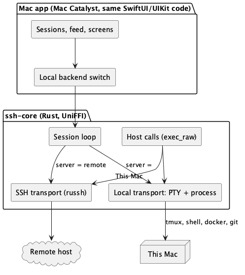

# Feature 58: macOS app (this Mac with and without SSH, and the remote hosts)

- **Slug**: `macos-app`
- **Target Release**: Milestone 47
- **Roles**: `doc-dev`, `rev`, `rust-core-dev`, `swift-bridge-dev`, `ios-ui-dev` (Mac Catalyst target), `rev`, `hacker`
- **Hacker Gate**: Yes (a local process and PTY spawned by the app, a new trust boundary: the app runs commands as the user without SSH)
- **Status**: Draft 2026-10-24. Decisions of the owner needed: section 8.

---

## 1. Problem and scope

The phone app manages terminal sessions and agents on the Mac over SSH. The owner wants the same app **on the Mac itself**:

1. **Remote**: the same servers, sessions, feed, approvals and screens as on the phone (SSH, Tailscale).
2. **This Mac**: terminal sessions and agents on the machine the app runs on, **without SSH and without Tailscale** (a local PTY and local tmux), with the same feed, hooks screen, approvals, git/file screens, Docker/Kubernetes and monitor screens.

Out of scope for the first release: Windows or Linux desktop clients, a menu-bar-only mode, an App Store build that spawns local processes (impossible in the sandbox, see 3).

## 2. What exists and what that means (measured 2026-10-24)

- The Rust core already ships a `macos-arm64` slice in the XCFramework; both Swift packages declare `.macOS(.v14)`. The core has no PTY or local process code: every host call goes through an SSH client (`exec_raw` on `SshSessionHandle`), and since M43 an *exec-only* handle exists (`new_exec_only`), so "a handle that only runs commands" is already a concept.
- The Swift app is 109 files. 29 of them (about 12,000 lines) use UIKit types (`UITextView` for the feed, `UIPasteboard`, `UIImage`, SwiftTerm's UIKit `TerminalView`, `UIKeyCommand` ...); 15 import UIKit without a guard. A native macOS build of the package fails at the first unguarded `import UIKit` (probe: `xcodebuild -destination 'platform=macOS'`, one error that hides the rest).
- A Rust target for Mac Catalyst exists (`aarch64-apple-ios-macabi`, `x86_64-apple-ios-macabi`), not installed yet; the XCFramework has no `maccatalyst` slice yet.
- The feed, hooks and approvals logic is Rust and SwiftUI; only the rendering views are UIKit.

## 3. Decisions with a recommendation

| # | Question | Options | Recommendation |
| - | -------- | ------- | -------------- |
| D1 | How to build the Mac UI | (a) **Mac Catalyst** from the iOS target: the 12,000 UIKit lines run as they are, one codebase, a universal bundle id possible. (b) A native AppKit/SwiftUI-for-macOS target: needs an AppKit twin for every UIKit view (feed text view, terminal view, pasteboard, images, key commands), roughly a second app. (c) "Designed for iPad" on Apple silicon Macs: zero work but cannot run local processes and has no real Mac behaviour. | **(a)**. Native AppKit later only if Catalyst's limits hurt (menu, windows) |
| D2 | Where local sessions get their terminal | (a) **In the Rust core**: a PTY (`openpty`/`forkpty`) and a child process, bytes through the same callback as an SSH session, so the existing `TerminalView`, resize, feed and all host calls work unchanged. (b) SwiftTerm's `LocalProcessTerminalView` (AppKit only, not Catalyst). | **(a)** |
| D3 | Distribution | (a) **Direct, Developer ID + notarization, hardened runtime, not sandboxed**: required to spawn a login shell, tmux, docker and read `~/.claude`. (b) Mac App Store: App Sandbox forbids spawning arbitrary processes and reading dot-folders, so only the remote/SSH half (and SSH to `localhost` as "this Mac") could ship. | **(a)** first. A sandboxed SSH-only variant can come later from the same code with `LOCAL_HOST` off |
| D4 | What "this Mac" is | (a) A built-in server entry "This Mac" that uses the local transport. (b) The user adds `localhost` as an SSH server (works today after Remote Login is on, no new code). | **(a)** plus (b) stays possible |
| D5 | Updates | Sparkle (own appcast) vs manual download | Sparkle, after the first release works; not needed for the first test build |

## 4. Design



### 4.1 Core: a local transport (new, phase B)

- `SshSessionHandle` keeps its API. A server configuration gets a **transport**: `Ssh` (as today) or `Local`.
- **Session loop (`Local`)**: opens a PTY pair, spawns the same command the SSH path starts (`tmux new-session -A -s <name> ...` through the user's login shell, `$SHELL -l -c`, never a hard-coded path), pumps bytes between the PTY master and the callback, applies `resize` with `TIOCSWINSZ` and `SIGWINCH`. The child gets the same environment rules as over SSH (login shell for `PATH`, `TERM=xterm-256color`, `COLORTERM=truecolor`). Disconnect closes the master and leaves tmux running, as `disconnect` does over SSH.
- **Host calls (`Local`)**: `exec_raw` runs `/bin/sh -c <command>` as a child process with the same 4 MB output cap, the same timeout, stdin support (`exec_raw_with_stdin`), and the same *argument rules*: every command string is already built by Rust from fixed argument lists with quoting, so the local path adds no new quoting surface. Streams (`exec_open`, feed watch) become child processes with piped stdout.
- **Files**: the remote file browser and the file preview read through `exec_raw` and the host helper over SSH today. Locally the helper (`ssh-app-host`, a Mac binary already embedded) runs as a child process and reads local paths; the credential blocklist and symlink rules apply unchanged (they live in the helper and core).
- **Host key and keys**: not used for `Local`. No password, key or fingerprint is involved; the trust boundary is "the user's own account on their own machine".
- **Mac Catalyst slice**: add `aarch64-apple-ios-macabi` (and `x86_64` if Intel is wanted) to `scripts/build-xcframework.sh`; the XCFramework gains a `maccatalyst` library. The `macos-arm64` slice stays (the package tests run natively).

#### Interface (proposed, phase B)

```rust
// UniFFI, next to `SshSessionHandle::new` and `new_exec_only`
#[derive(uniffi::Record)]
pub struct LocalSessionConfig {
    pub session_name: String,
    pub initial_cols: u16,
    pub initial_rows: u16,
    pub command: Option<String>,   // as SessionConfig.command
    pub start_dir: Option<String>, // `~/` allowed, as SessionConfig.start_dir
    pub multiplexer: MultiplexerKind, // tmux or Zellij; never `WindowsMux`
}
impl SshSessionHandle {
    #[uniffi::constructor]
    pub fn new_local(config: LocalSessionConfig) -> Arc<Self>;      // terminal session on this machine
    #[uniffi::constructor]
    pub fn new_local_exec_only() -> Arc<Self>;                      // commands only (server screens)
}
```

`connect`, `send_input`, `resize`, `disconnect`, `reconnect`, `execute_command_on_active_session` and every `host_api` method keep their signatures; only the transport behind them differs. Errors: no tmux on this Mac gives the same `ConnectionError` text as a remote host without tmux; a failed spawn is `ChannelError`; `connect` on a Mac without a login shell uses `/bin/zsh -l` only as the answer of `$SHELL` being unset (the shell is read from the account, never assumed).

**Child environment.** The child starts from a clean environment (`HOME`, `USER`, `LOGNAME`, `SHELL`, `TERM`, `COLORTERM`, a default `PATH`) and the login shell loads the rest, exactly as sshd gives a session. Nothing from the app's own environment (no variable the app or a test set) reaches the child, so a Finder-launched app and a terminal-launched one behave the same.

### 4.2 App: Mac Catalyst target (phase A and C)

- A Catalyst destination on the existing `SSHApp` target ("Mac (Designed for Mac)" with *Optimize Interface for Mac*), bundle id shared or `.mac` suffixed (D1 follow-up).
- Entitlements for the direct build: hardened runtime, no App Sandbox, Keychain access group as on iOS, network client; no other entitlement.
- UIKit code paths that need a Mac decision: `UIImagePickerController` camera (hidden on Mac), haptics (no-op), `UIPasteboard` (works), the keyboard accessory bar (hidden: a real keyboard), `UIApplication.shared.open` (works), Face ID (Touch ID or the password through `LocalAuthentication`, same policy `deviceOwnerAuthentication`).
- Mac UX (phase C): menu bar commands (New session, Close, Next/Previous tab, Cmd+1..9, Find, feed/terminal toggle) shared with M31's key commands, one window per session where possible (M31's rule), sidebar with servers and sessions, window state restoration, Dock badge for pending approvals.
- "This Mac" appears as the first server (D4) with a Local badge; its sessions, profiles, hooks and approvals behave like any server's. Agent hooks install into the user's own `~/.claude`, `~/.gemini` exactly as the host installer does remotely (same preview and confirmation).

### 4.3 What stays shared

Rust core (feed, hooks, approvals, vault, backup, host guard), the vault and iCloud sync (spec 56; the Mac uses the same vault and key choices), launch profiles, snippets, quick commands, AgentTraits, all SwiftUI screens.

### 4.4 Phases (gated)

- **A. Catalyst builds and runs the remote half**: macabi slice, target, UIKit fixes, remote sessions work on a Mac. No new trust boundary. `rev`.
- **Gate after A**: the owner uses A for a while. "This Mac" already works through SSH to `localhost` (Remote Login on) with no new code, so B is justified only if that is not enough (an extra setup step, no SSH wanted, no Tailscale, latency of the loopback hop). If A is enough, B, C's server entry and the new trust boundary are not built.
- **B. Local transport in the core**: PTY and local exec, tests on a private tmux socket (never the real server), `rev`, `hacker`.
- **C. Mac UX and "This Mac"**: menu commands, windows, server entry, Touch ID, Dock badge. `rev`.
- **D. Distribution**: Developer ID signing, notarization, hardened runtime check, Sparkle. `hacker` pass on the shipped bundle.

## 5. Constraints and invariants

- A local session never runs anything the user did not start: the app spawns a login shell and tmux, and commands from the app go through the same Rust builders as remote ones.
- Tests that start tmux or a shell never touch the real tmux server: a private socket, `TMUX` and `TMUX_PANE` removed, `HOME` untouched (AGENTS.md; incidents 2026-10-16 and 2026-10-17).
- Zero Battery Drain on a Mac laptop: no process and no polling while the app is in the background; local sessions detach (tmux stays) when the last window goes to the background, reattach on return.
- No secret in argv or logs; the Keychain access groups and the vault behave as on iOS.
- Payments stay switched off in the Mac build as well (`PAYMENTS` not set).

## 6. Examples

- *This Mac, agent*: open "This Mac", choose the Claude profile: the core opens a PTY, runs `$SHELL -l -c 'tmux new-session -A -s cc-1 claude ...'`; the feed reads the session file with the local helper; a tool call needing approval shows the same card; Approve answers through the local queue directory.
- *Remote from the Mac*: the same server list as on the phone (vault sync), connect over SSH exactly as on the phone.

## 7. Risks and open questions

- Catalyst renders SwiftTerm's UIKit view and the feed's `UITextView`; text input and selection need a real-Mac check (hardware keyboard, IME, mouse selection, scroll wheel).
- The XCFramework grows by one slice; build time grows (about one more Rust compile).
- A non-sandboxed, notarized app is a larger trust surface than the phone app: the `hacker` gate covers spawning, environment, the local helper and update delivery.
- Intel Macs: only if the owner wants them (`x86_64-apple-ios-macabi` and `x86_64-apple-darwin` are available).

## 8. Decisions needed from the owner

D1 (Catalyst), D2 (PTY in the core), D3 (direct distribution first), D4 ("This Mac" entry), D5 (Sparkle later), and whether Intel is needed. Recommendations are in section 3.

## Revision notes (`rev`, 2026-10-24)

- Added the proposed core interface (4.1) and the child-environment rule: the doc named a local process without saying what environment it gets, which is the first thing `hacker` would ask.
- Controversial, kept as a named tradeoff: **Catalyst looks like a scaled iPad app on a Mac** (controls, sidebars, no AppKit idioms). It is the cheapest way to reuse 12,000 lines of UIKit; a native AppKit target is a second app. Revisit after phase A with real screens.
- Controversial, kept: **a PTY in the core duplicates SwiftTerm's `LocalProcess`**. It is chosen because the same bytes then flow through the same `TerminalView`, callback, feed, resize and `host_api` code on iOS and Catalyst, and SwiftTerm's local process is AppKit-only.
- Controversial, resolved by design: **the local transport may be unnecessary**, since SSH to `localhost` gives "this Mac" today. The phases are now gated: B starts only after the owner has tried A (section 4.4).
- Controversial, kept: **direct distribution first** leaves the Mac App Store out; the sandbox makes local spawning impossible, and an SSH-only sandboxed variant remains possible from the same code.
