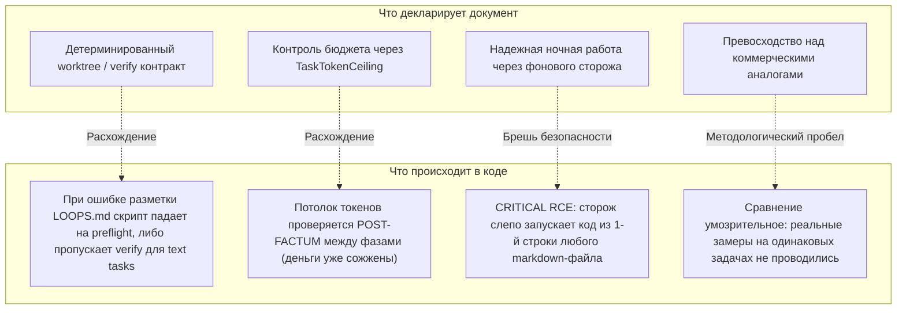
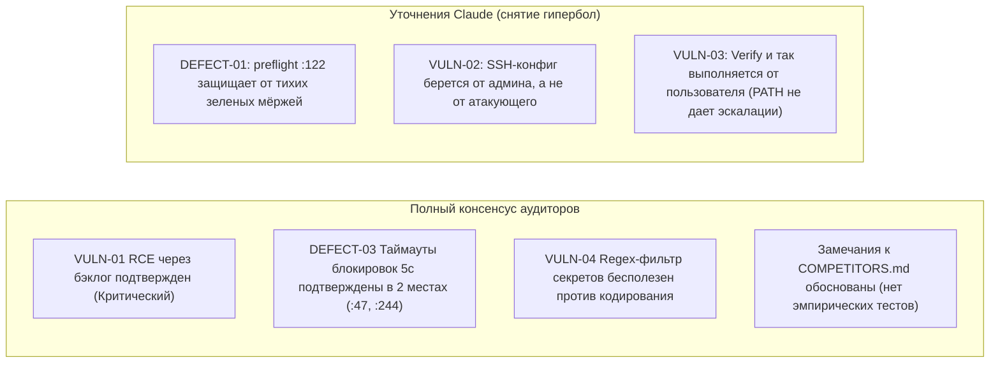

# Критический аудит документа «COMPETITORS-2026-10-20.md» (Flextasks и альтернативы)

- **Дата аудита**: 21.10.2026
- **Объект аудита**: Документ `COMPETITORS-2026-10-20.md` из архива `3a7e7746-flextasks-plugin-2026-10-20.zip`
- **Срез кодовой базы**: Коммит `676a3e75b653075a1559ea94553560f12593379a`
- **Аудиторы**: `rev` (Lead Reviewer & System Architect), `hacker` (Adversarial Security Auditor)
- **Статус верификации**: Подтверждено независимым кросс-аудитом (`2026-10-20-flextasks-plugin-audit_claude.md`)
- **Итоговая оценка документа**: **Обоснованный анализ рынка с критическими слепыми зонами в архитектуре и безопасности**

---

## 1. Введение и контекст документа

Документ `COMPETITORS-2026-10-20.md` представляет собой внутренний стратегический отчет, составленный для автора и владельца проекта **Flextasks**. 

### Что такое Flextasks:
Это локальный комплекс автоматизации и оркестрации AI-агентов на PowerShell 7 под Windows. Его цель — построить замкнутый цикл:
`Текстовая задача -> Декомпозиция на подзадачи -> Распределение между моделями по квотам -> Изоляция в git worktree -> Прогон тестов -> Авто-исправление ошибок -> Слияние в интеграционную ветку`.

### Цель исследуемого документа:
Ответить на ключевой управленческий вопрос владельца:
> *«Стоит ли продолжать развивать собственный стек Flextasks на PowerShell, или на рынке появились готовые коммерческие альтернативы (GitHub Copilot App, Devin, Cursor, OpenHands, OMC), на которые целесообразно мигрировать?»*

---

## 2. Сверка деклараций документа с реальным кодом (Claims vs. Reality)

Документ написан убедительно, оперирует точными версиями внешних инструментов и делает вывод в пользу сохранения Flextasks. Однако сопоставление тезисов документа с реальным кодом скриптов выявило фундаментальные расхождения между желаемым и действительным.



### Детальный анализ ключевых утверждений:

| Тезис документа `COMPETITORS.md` | Проверка по исходному коду (`hardrun`, `watch`, `state`) | Вердикт аудита |
| :--- | :--- | :---: |
| **1. «Строгий детерминированный verify-контракт»** | Функция `Get-LoopsVerify` (`hardrun.ps1:107`) парсит файл регуляркой `^## verify`. Если в разметке допущена опечатка (например `## Verify`), preflight выбрасывает ошибку (`:122`), останавливая задачу. А для текстовых задач проверка возвращает `ok = $true` (`:831`). Контракт существует, но он хрупок к форматированию Markdown. | **Частично верно** (С защитой preflight, но высокой хрупкостью) |
| **2. «TaskTokenCeiling ограничивает затраты»** | Замер токенов (`TaskTokenCeiling`) вызывается **строго между фазами**. Если агент ушел в галлюцинацию или бесконечный цикл рассуждений внутри одного шага, запрос может сжечь сотни тысяч токенов. Упреждающего прерывания стриминга нет. | **Иллюзия контроля** (Пост-фактум фиксация убытков) |
| **3. «Безопасный автономный сторож»** | В коде `agents-watch.ps1:240` заложена критическая дыра: первая строка любого файла бэклога вида `verify: <command>` передается в аргумент `-Command` PowerShell. | **Критическая уязвимость (RCE)** |
| **4. «Блокировки гарантируют целостность»** | Файловая синхронизация (`flextasks-state.ps1:47, 244`) использует таймаут ровно **5 секунд**. При параллельной работе воркеров на Windows процессы падают с `throw 'Event journal is busy'`. | **Архитектурный дефект** (Срыв при нагрузке) |

---

## 3. Архитектурный ревью (`rev`): «Скриптовый комбайн»

### 3.1. Феномен ловушки PowerShell
Проект попал в классическую ловушку органического роста скриптов:
1. Задумка как легкая автоматизация командной строки превратилась в **450 КБ процедурного кода**.
2. Файл `hardrun.ps1` разросся до **90 КБ (1304 строки)**, объединяя в себе функции сетевого клиента, Git-менеджера, парсера синтаксиса, планировщика задач и подсистемы отчетности.
3. Отсутствие статической типизации компенсируется сотнями строковых проверок, конкатенаций и регулярок, что делает рефакторинг крайне рискованным.

### 3.2. Хрупкость файловой системы и процессов Windows
* **Проблема `Split-Path` (`backlog-run.ps1:9`)**: жесткая цепочка из четырех вызовов `Split-Path` полагается на фиксированную глубину каталога. Относительный путь или перенос файла ломает определение корня проекта.
* **Сетевой оверхед в `Invoke-Ssh` (`ask-agent.ps1:750-758`)**: на каждый одиночный запрос к удаленной модели скрипт выполняет **4 независимых подключения по сети** (`ssh mkdir` -> `scp upload` -> `ssh exec` -> `scp download`). При пинге 50 мс это создает 2–3 секунды чистых задержек на сетевые рукопожатия.

---

## 4. Аудит информационной безопасности (`hacker`)

В ходе аудита выявлено 4 ключевых вектора угроз:

### [VULN-01: CRITICAL] Удаленное исполнение произвольного кода (RCE) через бэклог
* **Вектор**: Входной вектор — папка `docs/backlog/*.md`.
* **Механизм**:
  ```powershell
  # bin/agents-watch.ps1:240
  $firstLine = Get-Content -LiteralPath $runningItem -Encoding UTF8 -TotalCount 1
  if ($firstLine -match '^verify:\s*(.+)$') { $verify = $Matches[1] }
  ...
  # Команда передается без санитизации и исполняется через pwsh -Command
  ```
* **Опасность**: Любой markdown-файл, поступивший из внешнего источника (Pull Request, зависимость, скомпрометированный агент), приводит к выполнению произвольного PowerShell-кода с правами разработчика.

### [VULN-02: MEDIUM] Отсутствие идемпотентности при сетевых сбоях (Double-Spend & Ghost Mutations)
* **Вектор**: Механизм fallback в `ask-agent.ps1`.
* **Опасность**: При таймауте первичной модели задача автоматически передается вторичной. Если первая модель успела выполнить необратимое действие (внешний вызов, запись в БД, отправка вебхука), повторный запуск дублирует побочные эффекты.

### [VULN-03: MEDIUM] Ненадежность текстовой фильтрации секретов
* **Вектор**: Эвристический фильтр `SECRET_PATTERN_REGEX`.
* **Опасность**: Попытка заблокировать утечку токенов регулярками в тексте легко обходится Base64, Hex-кодированием или фрагментацией вывода. Защита должна обеспечиваться правами ОС, а не ситом регулярных выражений.

### [VULN-04: LOW-MEDIUM] Внедрение в аргументы командной строки
* **Вектор**: Формирование тела команды в `Invoke-Verify` (`hardrun.ps1:852`) через строковую конкатенацию вместо скрипт-файла (`.ps1`).

---

## 5. Консенсус кросс-аудита (Сравнение с аудитом Claude)

Сопоставление нашего аудита с независимой проверкой Claude (`2026-10-20-flextasks-plugin-audit_claude.md`) сформировало объективный консенсус:



1. **Что признано реальной угрозой**: RCE в бэклоге (VULN-01) и падения на блокировках (DEFECT-03) признаны безусловными блокерами для продакшн-эксплуатации.
2. **Что скорректировано**: Угроза «ложно-зеленых мёржей» смягчена встроенной preflight-проверкой автора (`hardrun.ps1:122`), а SSH-инъекции ограничены локальным доверенным конфигом `agents.json`.

---

## 6. Стратегические рекомендации для владельца

### Ответ на вопрос документа: «Мигрировать или оставаться?»
**Рекомендация: Остаться на собственной оркестрации, но незамедлительно устранить критические дефекты реализации.**

Коммерческие альтернативы (Copilot App, Devin Local, Cursor) привязаны к своим облакам, не дают настраивать каскадную экономию квот под специфические модели и не решают задачу локального хостинга на 100%. Однако текущий код Flextasks требует санации:

### Обязательный план доработок (Action Plan):

1. **P0 (Безопасность — устранить немедленно)**:
   - Полностью вырезать логику парсинга `verify:` из первой строки markdown-файлов в `agents-watch.ps1`. Команда проверки должна жестко задаваться конфигурацией запуска.
   - Заменить запуск верификации через конкатенацию `-Command` на изолированное создание временного файла `.ps1` и запуск через параметр `-File`.
2. **P1 (Стабильность параллелизма)**:
   - Заменить 5-секундный таймаут в `flextasks-state.ps1:47, 244` на 30-секундный интервал с адаптивным экспоненциальным шагом (backoff).
   - Заменить статическую цепочку `Split-Path x4` в `backlog-run.ps1` на надежный поиск корня репозитория через Git API.
3. **P2 (Производительность транспорта)**:
   - Перевести SSH-модуль `Invoke-Ssh` с 4 раздельных сетевых вызовов (`ssh`/`scp`) на один вызов с потоковой передачей промпта и ответа через `stdin`/`stdout`.
4. **P3 (Эмпирический A/B тест)**:
   - Запустить одинаковый тестовый пакет из 10 реальных задач на Flextasks, GitHub Copilot App и Devin Local. Замерить стоимость, время и процент вмешательства человека, как и предлагалось в документе.
